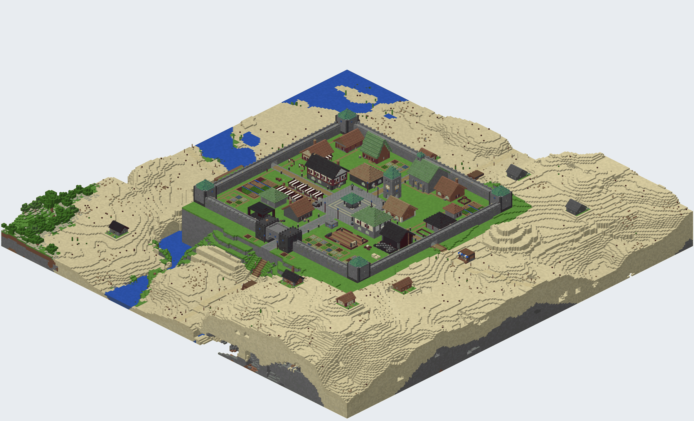
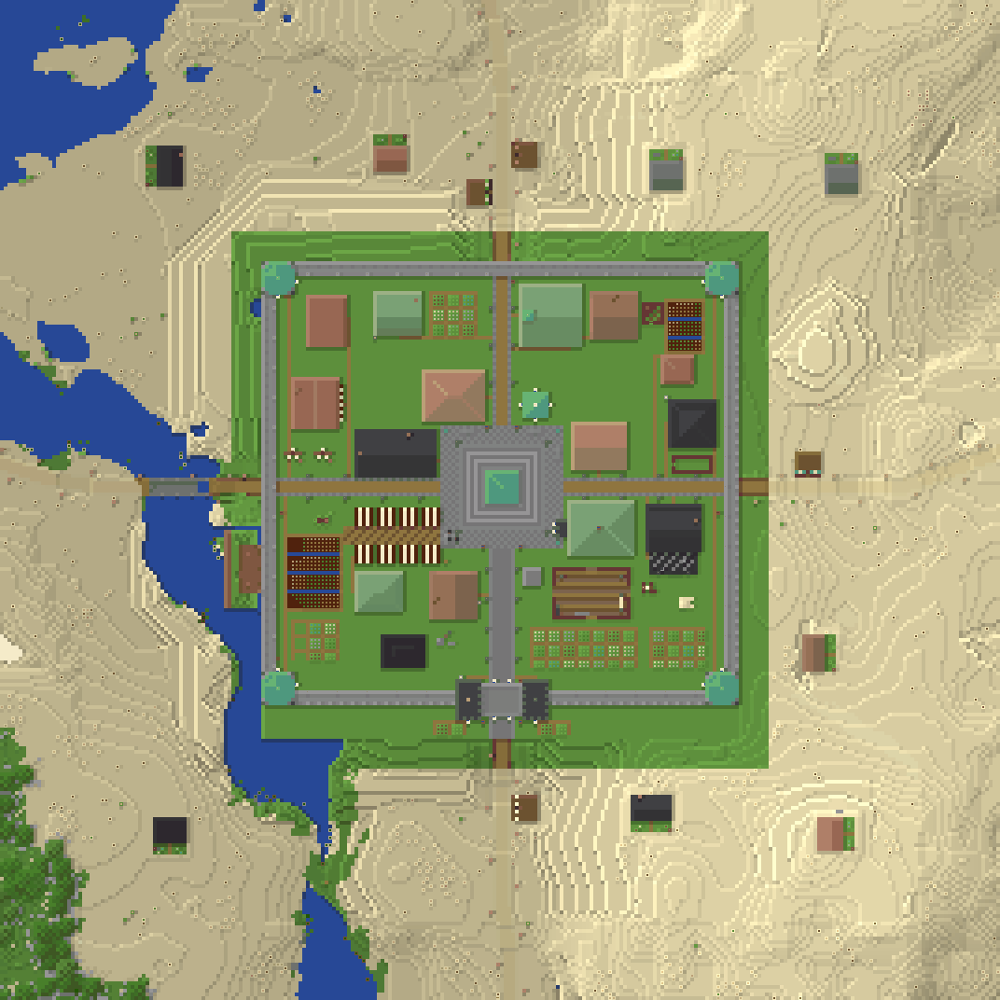
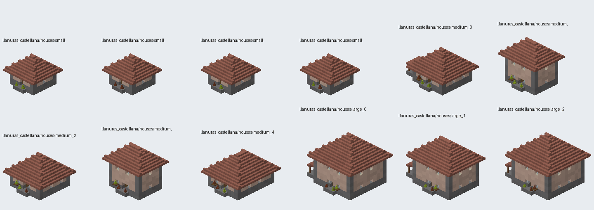
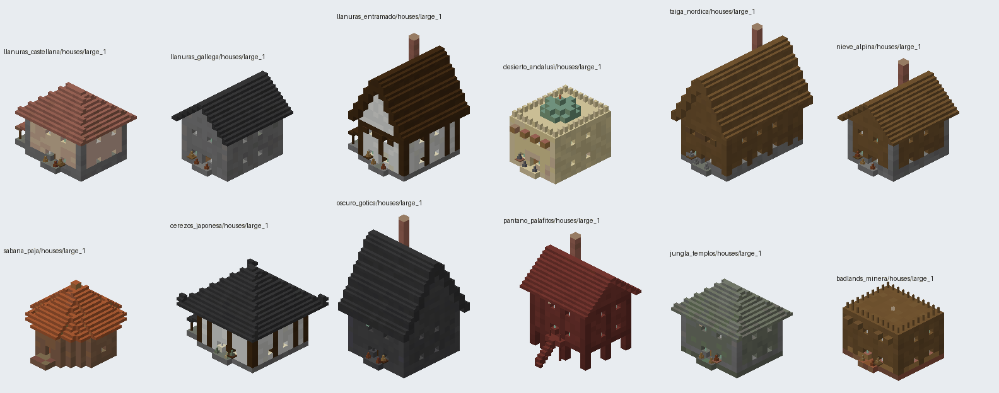
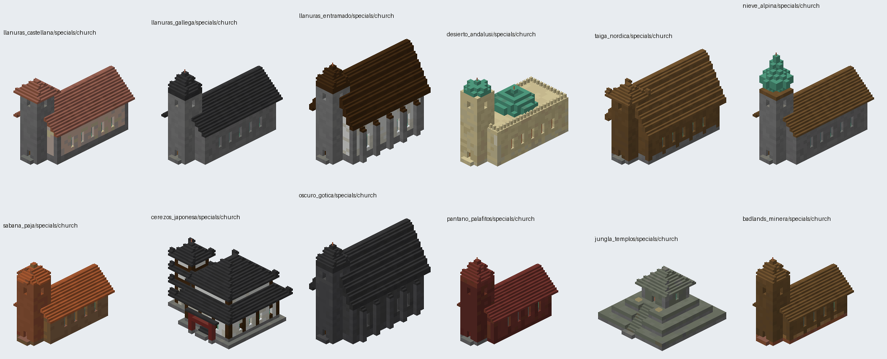
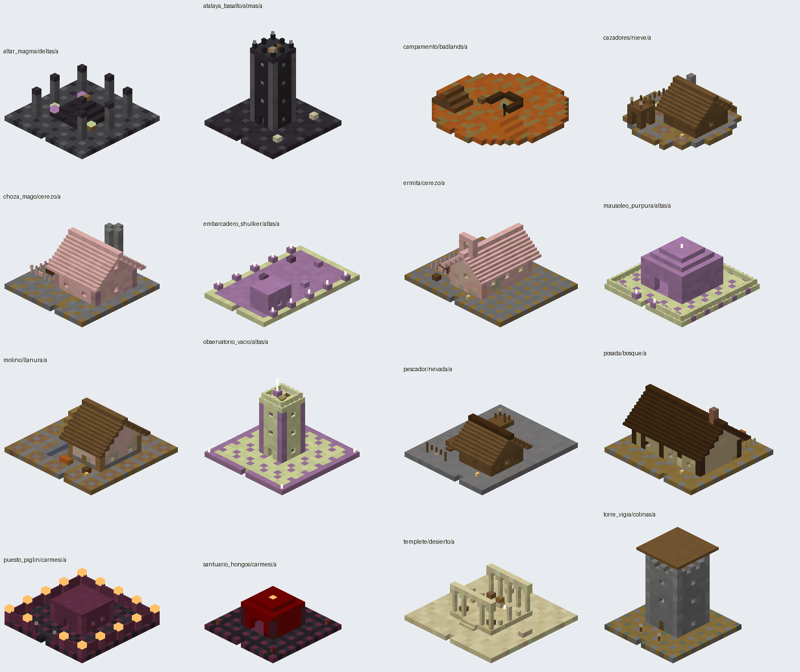
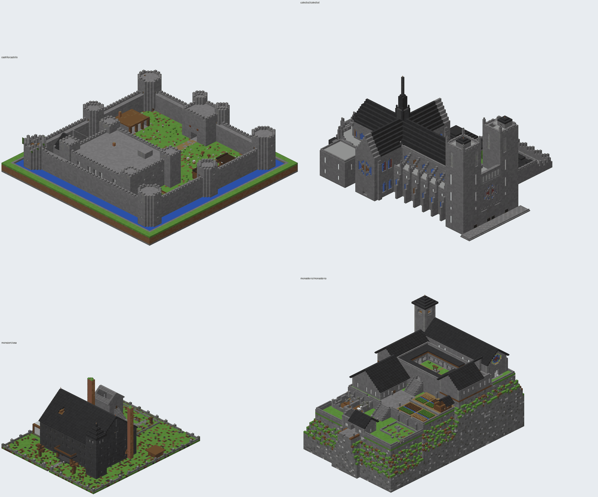

# Visual diagnosis (design pass, Nov 2026)

What the mod looks like today, judged from pictures and not from counters, ordered by how much a player sees it. Every
picture here was drawn by `tools/gen/look.py` (real texture colours, real block shapes) from the templates the generator
writes or from the region files of a saved world. The world is the owner's: seed `-2071092601429184301`, large biomes,
hard, the Herald's House on steep desert by a river (`tools/smoke/herald_steep.py` leaves it behind).

This is a diagnosis and a proposal. The taste is the owner's: section 3 lists what needs a decision before it is built.

## 1. What is weak, by impact

### 1.1 The Herald's House (the first thing every player sees)

1. **A green square dropped on the desert.** The template carries its own grass, and so do the 8-block margin and
   every grounds house's plot. In any biome that is not grassland the town is a lawn-coloured rectangle with a ruler-straight
   edge, and each outlying house sits on its own green doormat. This is the largest single fault and it is not a matter
   of style.
2. **The town is mostly lawn.** 17 buildings in 120 x 110 blocks: about a fifth of the ground inside the wall is built,
   the rest is one flat grass plane crossed by one-block dirt paths. Nothing stands between buildings: no trees (they
   were removed for the fire rule), no hedges, no yards, no walls, no height. From the plaza a player sees a building,
   forty blocks of grass and the wall.
3. **The wall is a 450-block ruler.** One profile, one material mix, no buttress, no intermediate tower, no change of
   height between the corners; from outside it is a grey band. The gatehouse towers are two blank deepslate cubes
   (`diagnosis/05_spawn_gatehouse.png`).
4. **Roofs are single planes of a single block.** The materials are well chosen and varied (weathered and exposed
   copper, brick, mud brick, deepslate tile), but every roof is one unbroken sheet of one block: no ridge, no eaves
   line, no dormer, few chimneys. Seen from the wall walk and from the roads coming in, the roofs are most of what
   there is to see.
5. **The plaza reads as paving, not as a place.** Good centre (dais, canopy, bell); around it, 33 x 33 of chequered
   stone with four benches and four lamp posts (`diagnosis/04_spawn_plaza.png`).
6. **What is around the town.** The eight roadside huts are the same flat-roofed cube with a different awning colour
   (`diagnosis/06_spawn_huts_and_houses.png`); the five grounds houses are the same gabled box in five materials. Where
   the platform stands above the land (the river side here), the foundation shows as a bare stone face ten blocks high.

What is good and stays: the layout (roads, plaza, door rule, residents' routes), the interiors (the inn, the library
and the smithy are furnished with care), the market, the building recipes' variety of *function*.

### 1.2 Roads

Outside the town the built roads take the local material and almost disappear in the desert (fine, and correct). Their
furniture is one lamp-post design repeated every 7 blocks and a sign; no milestone, no bench, no shrine, no low wall,
no change at a bridge head. The village-to-village road pieces were not looked at in a world yet (phase 2).

### 1.3 Villages (36 styles)

1. **Inside a style every house is the same house.** `houses.rect_house` builds one symmetric box with the door in the
   middle and one roof; the twelve houses of a style differ by one or two blocks of width. The four "small" ones are
   indistinguishable. A village street is the same object repeated.
2. **Between styles the difference is the roof and the material, not the building.** Roof shapes do vary (hip, gable,
   steep, flat with parapet, cone, pagoda) and four or five styles have a shape of their own (the Japanese one, the
   stilt houses, the jungle temple). The rest are the same box re-skinned: eight of the twelve churches above are one
   template in eight colours.
3. **Walls are one block.** A plinth course and the wall block; no posts, no timber frame except the two styles that
   are about it, no texture mix, no sill, no lintel, nothing that casts a shadow.
4. **Streets and plazas are bare.** A street piece is a strip of path; the plaza is a ring of path round a fountain
   with four trees (`diagnosis/10_village_parts.png`).

### 1.4 Medium structures (16 kinds) and unique structures (22)

- The uniques are the best work in the mod (the monastery on its crag, the cathedral's buttresses and roofs). Their
  weakness is texture: the castle is one grey from moat to merlon, with a flat slab for a keep roof.
- The mediums are small and mostly fine in shape; several stand on a rectangular carpet of a foreign block (the same
  "doormat" as the town), and the overworld ones share one gabled box (hunters, fisherman, hermitage, wizard's hut,
  mill).

### 1.5 Interiors

Better than the exteriors. The spawn town's are good. Village houses are furnished by one allocator (`houses.furnish`):
the same six pieces against the walls, in the same order, in every house of every style.

## 2. Proposed direction

One sentence: **keep every layout, id and rule; spend the detail where the eye lands (ground, silhouette, wall texture,
what stands between buildings), and make two neighbours never identical.**

| Phase | What | Why first | Expected cost |
|---|---|---|---|
| 1 | **The Herald's House sits in its land**: the ground outside the wall takes the biome's own surface (no green rectangle), the margin's edge is feathered, grounds houses lose their doormat. **The wall gets relief** (buttresses, a string course, towers along the long sides, a real gatehouse). **Roofs get ridges, eaves, dormers and chimneys.** | It is what every player sees first, and none of it is a style choice. | Blocks only: no new entities, no new block entities, light sources unchanged or fewer. Placement time re-measured (2,229 ms over 414 ticks today, one chunk per tick). |
| 2 | **Inside the town**: yards, low walls, hedges of fireproof material, paved lanes instead of dirt threads, a plaza with a reason to stand in it; roadside huts and grounds houses each with a shape of its own; road furniture. | Second thing seen. Needs the owner's answer to 3.1-3.3. | A few dozen more lanterns at most, measured; no new villagers. |
| 3 | **Village houses**: asymmetric plans (L, lean-to, porch, jetty), wall texture and structure per style, chimneys, varied interiors, inside the footprints the jigsaw already uses. | Largest amount of repetition in the mod. | Generation cost test (`generation_cost.py`); templates grow a little, no new entities. |
| 4 | **Village streets, plazas and special buildings**; the styles that are only a re-skin get a building of their own. | | Same. |
| 5 | **Mediums and uniques**: texture and remates (the castle first), no doormats. | Already the best part. | Same. |

Only new chunks and new towns change: nothing here rewrites what a world already holds.

## 3. Decisions that are the owner's

1. **Inside the wall, grass or the biome's ground?** In a desert the town is green today. Proposal: outside the wall the
   biome's own ground always; inside, keep the gardens green (an oasis behind walls) but pave more of it. The alternative
   is a town that changes its ground with the biome (sand and dry gardens in the desert, snow in the tundra).
2. **Trees inside the town.** There are none (the fire rule: nothing that burns where lightning can reach, and every
   leaf burns). The only fireproof "tree" is a built one (crimson or warped stems with wart blocks). Proposal: no fake
   trees; hedges of mossy stone walls, potted plants and vines of stone, and real trees only outside the wall, where the
   grounds already plant cherries.
3. *(withdrawn)* An earlier draft asked whether to cut down the "eight oxidized copper roofs". That came from a colour
   bug in the first renders (every waxed copper drew as oxidized); the town's roofs are already a varied palette and
   their materials stay as they are.
4. **How far villages may change shape.** Asymmetric houses inside today's footprints are safe. Styles with a building
   type of their own (4.) change what an existing style looks like in new chunks: yes or no.
5. **Wear.** How ruined should things look? Proposal: lived-in, not abandoned: moss and cracks low on walls and near
   water, never holes.
