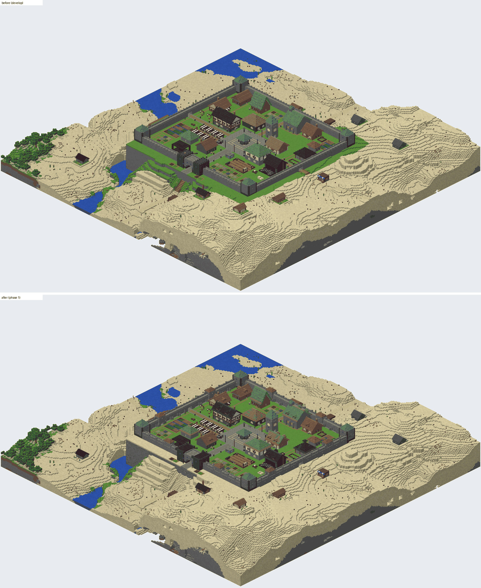
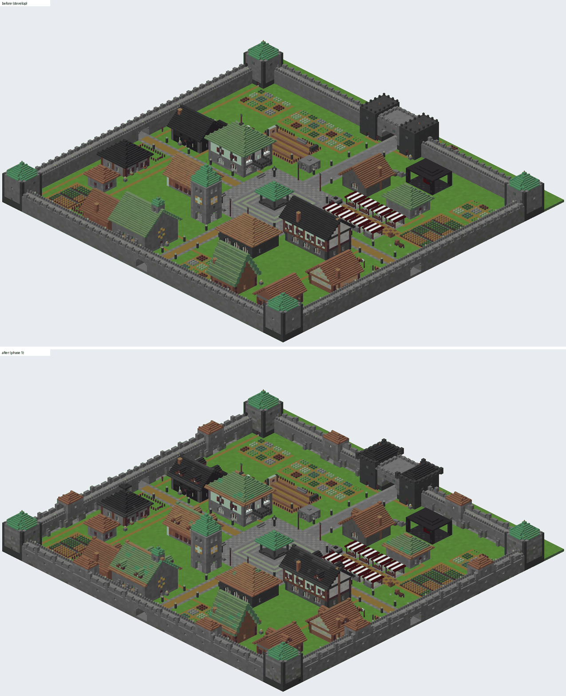
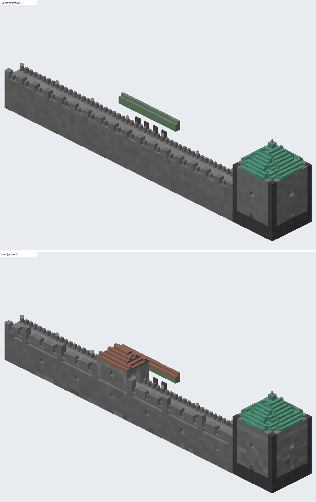
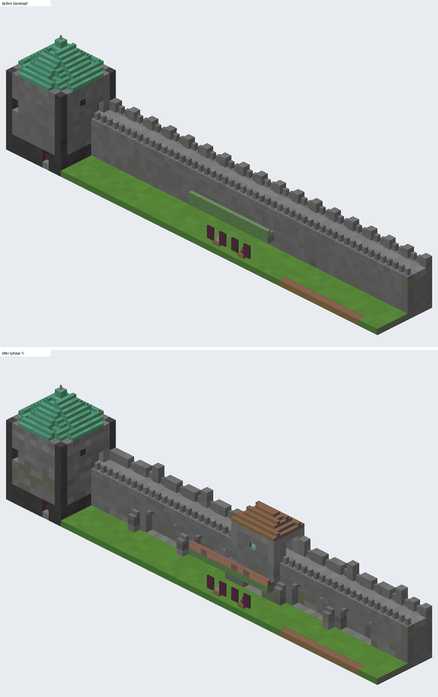
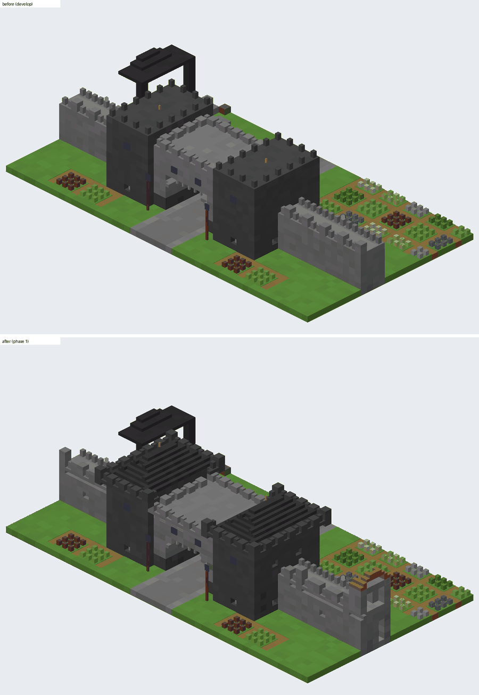
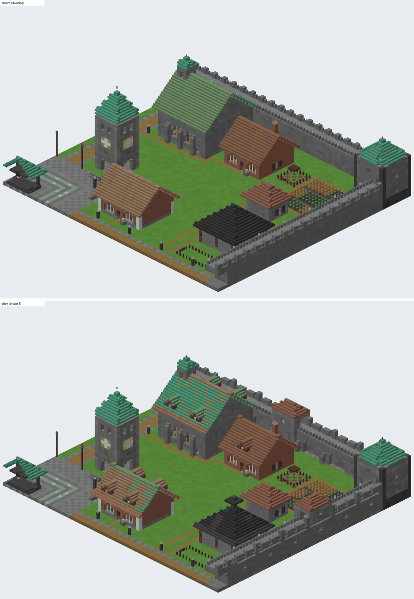

# Design pass, phase 1: the Herald's House in its land, with a skyline

Before and after, drawn by `tools/gen/look.py` from the same sources (the saved world of `tools/smoke/herald_steep.py` on
the owner's seed, and the template). Nothing here chooses a style: no material of any building changed.

| | |
|---|---|
| The town on the owner's desert spawn |  |
| The template, from the north-west |  |
| The wall from outside |  |
| The wall from inside |  |
| The gatehouse |  |
| Roofs (the north-east quarter) |  |

What changed:

- **Ground.** The margin round the wall, the forecourt and the grounds houses' plots keep the land's own surface. Read
  back from the region files: 83 % of the land columns round the wall were grass on this desert; 3 % now (the river
  bank's own).
- **Wall.** Plinth, pilasters into taller merlons, corbel course, arrow loops, blind arches and buttresses inside,
  weathering in patches, eight mural towers.
- **Gatehouse.** Machicolations, string courses, tiled roofs inside the parapets.
- **Roofs.** Eaves, ridge, patches of a kin material, dormers on long gables, a lantern on wide hips.

What it costs (same machine, idle, two rounds each):

| | before | after |
|---|---|---|
| Non-air blocks in the template | 110,348 | 111,522 (+1.1 %) |
| Block entities / entities / light sources | 122 / 88 / 192 | 122 / 88 / 192 |
| Town build, server thread (414 ticks, a chunk per tick) | 2,143 and 2,255 ms | 2,055 and 2,382 ms |
| Roads build | 163 ms | 134-174 ms |
| Grounds build | 199 ms | 188-221 ms |

Not done here, and why: what stands *between* the buildings (the lawn inside the wall), the plaza, the roadside huts
and the grounds houses' shapes wait for the owner's answers to the diagnosis (section 3) and are phase 2.
