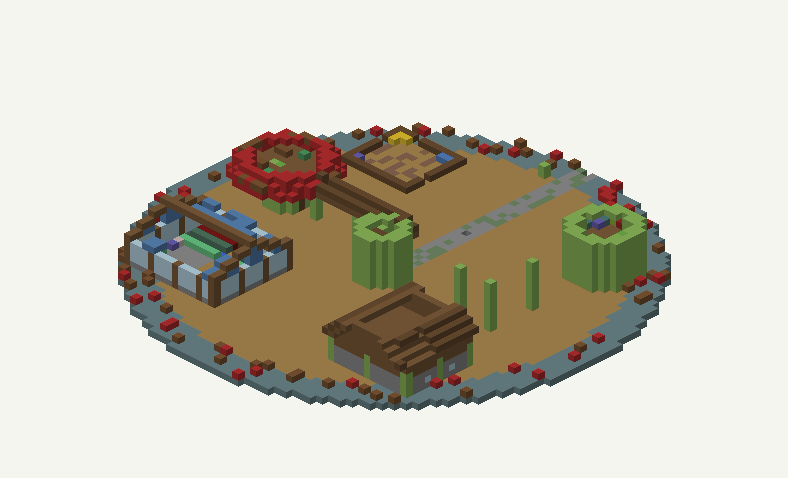
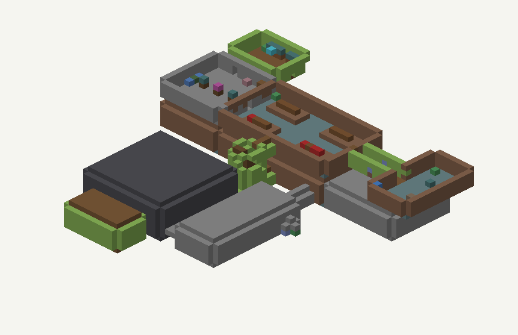

# Laboratorio del micólogo (`heraldia:unicas/laboratorio_micelio`)

Un antiguo jardín botánico de los campos de champiñones, construido entre y dentro de **tres champiñones gigantes**
unidos por pasarelas. Maese **Ambrosio**, el micólogo, vivía en el sombrero del más alto y buscaba en las esporas un
remedio para todos los males; bajo el micelio excavó sus criaderos y su laboratorio. Cuando le falló la última prueba,
la hizo en sí mismo: ahora es **Maese Ambrosio, el Esporado**, y espera en la cámara de la cepa madre con las setas
creciéndole en los huesos.

Es una estructura original: no copia ningún laboratorio ni ninguna casa-seta de otro juego o mod. Se distingue de la
torre de mago (también con laboratorio e invernadero) en que no hay torre ni muros: es un jardín abierto en el que los
edificios son los propios champiñones, con la vida (cultivos, fauna, criaderos) como tema, y todo lo valioso está bajo
tierra.

## Bioma y colocación

- Bioma: campos de champiñones, más `#c:is_mushroom` (que en vanilla es exactamente ese bioma: entran los campos de
  champiñones de mods de biomas; `biomas.comprobar` lo verifica). Hasta ahora no había ninguna única en él.
- **Un bioma muy raro.** Medido con `/locate biome minecraft:mushroom_fields` desde 25 puntos de una rejilla de
  ±20.000 bloques (semilla de la prueba): el más cercano estaba de media a 3.600 bloques (de 960 a 7.347). Con la rejilla
  normal (una candidata al azar por casilla de 4.000 bloques) la candidata casi nunca caería en una isla. Por eso esta
  única activa `candidata_en_bioma`: la rejilla `heraldia:rejilla` lleva el campo `bioma` y la candidata de cada casilla es
  el punto de una malla de 128 bloques (dentro de la misma ventana del random_spread, así que dos laboratorios nunca
  quedan a menos de la distancia mínima) que cae en el bioma y tiene más vecinos a 64 bloques también en él (el sitio
  más metido en la isla; hacen falta 6 de 9). Si la casilla no tiene ninguno, no hay candidata. Ver `GridPlacement`.
- Rareza: `spacing` 250 / `separation` 190 chunks por defecto (como mucho una cada ~3.000-5.000 bloques), configurable en
  `config/heraldia.json` como las demás (`unicas.laboratorio_micelio.activada`,
  `unicas.laboratorio_micelio.separacion_bloques`). Sale en las islas que caen en la ventana de su casilla (más o menos la
  mitad).
- Dos piezas rígidas unidas por un jigsaw vertical bajo la senda de entrada (`down_north` → `up_north`, misma rotación):
  - `jardin` (64 × 20 × 64): un disco de 64 de diámetro; su capa y = 0 es el suelo (los pies van a y = 1).
  - `galerias` (58 × 14 × 56): todo lo que queda por debajo de y = 0. **Rellena toda su caja**: tierra en las dos capas de
    arriba, piedra debajo, y forro (micelio, adobe y barro compacto en las galerías húmedas, ladrillo de piedra en el
    laboratorio, tablones y tallo en los pasillos, pizarra abismal labrada en la cámara de la cepa madre) en toda cara que
    da al aire, para que no salgan manantiales ni liquen dentro.
- Adaptación `beard_thin`: el terreno se ajusta a la base del jardín y las galerías quedan a su profundidad, sin cráter.
  Las islas de champiñones son bajas: si un borde del disco cae sobre el agua, el ajuste levanta la orilla bajo él (como
  una playa) en vez de dejarlo colgando. Dentro del jardín (radio 28) hay aire explícito hasta 8 bloques sobre el suelo.
- **No nacen champiñones gigantes en el jardín**: el suelo es tierra de camino (los champiñones gigantes piden micelio,
  tierra o podsol debajo); el corral es de tierra de camino y barro compacto. Fuera del radio 28 el suelo es micelio con
  setas sueltas: ahí la isla vuelve a crecer y el jardín se funde con ella. La auditoría falla si queda micelio o tierra
  descubierta dentro del jardín (salvo bajo techo).

## El jardín (pies a y = 1)

Coordenadas: x de oeste a este (0..63), z de norte a sur (0..63); la entrada está al norte (z = 0). Planos en
[`laboratorio_micelio/planos.txt`](laboratorio_micelio/planos.txt).

- **Senda** de ladrillo de piedra de la entrada a la puerta del champiñón grande, con el cartel «Jardín del micólogo. Se
  ruega no pisar las setas».
- **Champiñón rojo grande** (centro): tallo hueco de 7 de ancho con la **escalera de caracol** (`piezas.spiral_stair`)
  de las galerías (pies -11) al sombrero (pies 13), con setas luminosas en la pared; puertas al jardín y a la pasarela
  baja. En el **sombrero**, una cúpula de 19 de ancho, la **casa del micólogo**: cama, estanterías, mesa, alambique,
  caldero, tonel y el cofre `estudio`. Tras el **tapiz rojo** de un tabique de tallo, la **alcoba oculta** (sin otra
  salida): atril y cofre `alcoba`. Una puerta al este da a la pasarela alta.
- **Champiñón rojo pequeño** (oeste): escalera de mano en el tallo y, en el sombrero, el **dormitorio de los ayudantes**
  (dos camas, dos cofres `ayudantes`, mesa de trabajo).
- **Champiñón pardo** (noreste): tallo ancho con la **biblioteca de esporas** (estanterías, atril, mesa con velas y el
  cofre `biblioteca`, que guarda el **pliego de la Crónica**) y encima el **herbario** (vasijas con muestras, macetas con
  setas y hongos del Nether, tonel `herbario`); una escalera de mano sube al **secadero**, el sombrero plano con
  barandilla, compostadores, toneles y el tonel `secadero`.
- **Pasarelas** de pícea con barandilla: la baja (pies 7) del tallo grande al dormitorio y la alta (pies 13) del sombrero
  grande al secadero, sobre postes de tallo.
- **Invernadero** (suroeste): estructura de troncos descortezados, muros de cristal y cubierta de cristal a dos aguas.
  Bancales de **verruga del Nether** sobre arena de almas, de **flor antorcha** y de remolacha, regados por una acequia;
  al fondo **bayas dulces**, **cacao** en troncos de jungla, una **flor de coro** sobre piedra del End y **bayas
  luminosas** colgadas del caballete. Cofre `invernadero`.
- **Destilería** (sureste): ladrillo de piedra con postes de tallo y cubierta de pícea a dos aguas; mostrador con tres
  alambiques, calderos, toneles, un alambique de cobre, el cofre y el tonel `destileria` y el cartel «Nada sale de aquí
  sin su etiqueta».
- **Corral de los champiñocas** (norte): cercado con portillo, heno, abrevaderos, el tonel `corral` y **tres
  champiñocas** (dos rojos y uno pardo).

## Las galerías (pieza `galerias`)

Nivel alto (pies a y = -5) y nivel bajo (pies a y = -11), unidos por la escalera del champiñón grande.

1. **Criaderos de setas** (nivel alto): cuatro bancales de adobe con micelio y setas, setas luminosas en el techo y
   liquen luminoso; dos cofres `criadero` y el cartel «Humedad: alta. Luz: la justa».
2. **Laboratorio** (oeste): mesa con alambiques, calderos, toneles, el cofre `laboratorio` y el cartel con **la receta de
   la cura**: «espora, verruga y luz. Nada más». Un panel de tallo del muro norte es la **puerta secreta** (puzle 2): su
   palanca está a ras de suelo, tres bloques más allá. Detrás, el **cepario** (sala oculta): estanterías con vasijas de
   cepas, atril y el cofre `cepario`.
3. **Pasillo del cable trampa** (este): **trampa 1**, cable trampa con dos dispensadores de flechas a la altura de la
   cabeza.
4. **Criadero abandonado**: bancales podridos, telarañas, el cofre `galeria` y un **generador de arañas**, a oscuras.
5. **Galería de la luz** (nivel bajo): micelio, setas luminosas, liquen y el cofre `galeria`.
6. **Sala de los capullos** (oeste): telarañas por todas partes, el cofre `capullos` y un **generador de arañas de
   cueva**, a oscuras.
7. **Experimentos fallidos** (este): jaulas de barrotes vacías, la mesa de la prueba 32 («en mí»), el cofre
   `experimentos` y un **generador de zombis**, a oscuras.
8. **Sala de los reactivos** (puzle 1): el muro oeste tiene cinco **frascos** de andesita pulida, cada uno con su palanca
   y su cartel: ojo de araña, espora roja, pólvora, verruga del Nether y polvo de piedra luminosa. La puerta de piedra
   cincelada se abre solo con **la cura: espora, verruga y luz** (y nada más). Las palancas buenas apagan tres antorchas
   inversoras que alimentan la línea de los pistones; las falsas la alimentan directamente con polvo, así que con
   cualquier frasco falso la puerta se queda cerrada (o se vuelve a cerrar). Es la pieza del muro de las runas y de las
   piedras de las estaciones (`piezas.combo_door` con palancas falsas), ya probada en servidor, aquí con cinco palancas.
   Al este, el **armario de reactivos**: un nicho con dos placas de presión y un dispensador de flechas a cada lado de
   cada placa (**trampa 2**), y al fondo el cofre `reactivos`.
9. **Cámara de la cepa madre** (oculta): seis de alto, pizarra abismal labrada, un **champiñón gigante creciendo bajo
   tierra** con setas luminosas bajo el sombrero, un anillo de setas, tapices pardos y el cofre `cepa`. La ronda el
   **guardián**, **Maese Ambrosio, el Esporado**: un esqueleto pantanoso (las setas ya le crecen) con un sombrero de
   champiñón rojo, 50 de vida y armadura 4.
10. **Cámara del tesoro**, al sur de la cepa madre: cofre **premium**, bloque de oro con velas, tonel, vasijas y postes de
    tallo.

## Recorrido del jugador

Entrada → jardín (libre: invernadero, destilería, corral) → biblioteca de esporas, herbario y secadero por el champiñón
pardo → puerta del champiñón grande → escalera arriba hasta la pasarela baja (dormitorio) o la casa del micólogo (tapiz →
alcoba; pasarela alta → secadero), o abajo → criaderos → laboratorio (palanca → cepario), pasillo del cable trampa →
criadero abandonado. Más abajo → galería de la luz → capullos, experimentos fallidos, sala de los reactivos (armario con
la trampa) → la cura → cámara de la cepa madre → tesoro. Todo tiene vuelta a la entrada sin saltos (lo comprueba la
auditoría; de la acequia del invernadero se sale nadando).

## Puzles y trampas (todo en reposo y coherente al generarse)

- **Puzle 1, los reactivos** (`piezas.combo_door` con tres palancas y dos falsas): pistones pegajosos extendidos sujetando
  dos bloques de piedra cincelada; la línea de polvo va dentro del muro (cuatro de grueso: palancas, antorchas o polvo de
  las falsas, puerta y pistones con la línea, y la cara de la cámara de la cepa madre). Se prueban las 32 combinaciones.
- **Puzle 2, el panel del cepario** (`piezas.lever_door`): dos bloques de tallo al fondo de un nicho; la palanca apaga la
  antorcha inversora y los pistones los recogen. Pistones y antorcha quedan dentro del muro.
- **Trampa 1**: cable trampa tenso entre dos ganchos con un dispensador encima de cada gancho (`piezas.tripwire_trap`).
- **Trampa 2**: dos placas de piedra en el armario de reactivos, cada una con un dispensador a cada lado
  (`piezas.plate_trap`).

## Enemigos y entidades

- **3 generadores**, todos bajo tierra y a oscuras (luz de bloque 0 en un radio de 4; las setas luminosas de los
  criaderos y de la galería de la luz quedan a más de 15 pasos de luz): arañas (criadero abandonado), arañas de cueva
  (capullos) y zombis (experimentos fallidos). En los campos de champiñones no aparecen monstruos de forma natural, pero
  los generadores no dependen del bioma: solo piden oscuridad.
- **Guardián**: Maese Ambrosio (único con la etiqueta `heraldia_guardian`; suelta su trofeo si lo mata un jugador, y su
  botín de esqueleto pantanoso de siempre; el sombrero no cae). Un esqueleto pantanoso y no un zombi porque los zombis
  de una plantilla pasan por `finalizeSpawn` y podrían salir bebés.
- **Fauna**: tres champiñocas en el corral (persistentes). En total, **4 entidades** por estructura.

## Cofres (22) y botín

Más ricos cuanto más escondidos; cada tabla tiene un grupo extra `solo_sin_lootr`. Pociones, ingredientes raros y
libros.

| Tabla | Dónde | Contenido |
|---|---|---|
| `ayudantes` (2) | dormitorio | setas, estofado, pan, frascos, cuerda, velas, papel; extra: esmeralda, pepitas, Estofado de la casa |
| `estudio` | casa del micólogo | libros, papel, tinta, frascos, ojos de araña, visión nocturna, Cuaderno de cepas; extra: libro encantado, Lupa del micólogo |
| `alcoba` | alcoba oculta | oro, esmeraldas, Cuaderno de cepas, Elixir de micelio, libro encantado, regeneración; extra: diamante, manzana dorada, Bastón de cepa |
| `biblioteca` | biblioteca de esporas | libros, papel, frascos, setas y hongos del Nether, Cuaderno de cepas **y el pliego de la Crónica**; extra: libro encantado |
| `herbario` (tonel) | herbario | setas, helecho, musgo, liquen, bayas luminosas, hongos; extra: verruga, Espora dorada |
| `secadero` (tonel) | secadero | setas a montones, algas secas, polvo de hueso, azúcar; extra: piedra luminosa |
| `invernadero` | invernadero | verruga, semillas de flor antorcha, vaina de jarra, bayas, cacao, coro; extra: sandía reluciente, zanahoria dorada |
| `destileria` (cofre y tonel) | destilería | frascos, verruga, azúcar, redstone, piedra luminosa, pólvora, pociones; extra: polvo de blaze, crema de magma, Tónico del micólogo |
| `corral` (tonel) | corral | trigo, cuencos, cuero, cubo, rienda; extra: silla de montar |
| `criadero` (2) | criaderos | setas, micelio, liquen, polvo de hueso, pepitas de hierro; extra: hierro, verruga |
| `laboratorio` | laboratorio | frascos, ojos de araña, redstone, pata de conejo, membrana de fantasma, pociones; extra: Tónico del micólogo, lágrima de ghast |
| `galeria` (2) | criadero abandonado, galería de la luz | cuerda, ojos de araña, huesos, carbón, bayas luminosas; extra: hierro, manzana dorada |
| `cepario` | cepario oculto | libros encantados, Cuaderno de cepas, Espora dorada, lágrima de ghast, lapislázuli; extra: diamantes, disco «mall» |
| `capullos` | sala de los capullos | cuerda, telarañas, ojos de araña fermentados; extra: lingotes, poción arrojadiza de veneno |
| `experimentos` | experimentos fallidos | carne podrida, debilidad arrojadiza, fuerza, zanahoria dorada; extra: diamante, Remedio contra todo |
| `reactivos` | armario de reactivos (trampa) | verruga, blaze, piedra luminosa, crema de magma, lágrima de ghast, aliento de dragón; extra: diamantes, bloque de esmeralda |
| `cepa` | cámara de la cepa madre | bloques de champiñón, setas luminosas, lapislázuli, Tijeras de podar, maestro tortuga; extra: diamantes |
| `premium` | cámara del tesoro | 90 %: Espora dorada, Sombrero de ala ancha, Lupa del micólogo, Remedio contra todo, Elixir de micelio, adornos de armadura (anfitrión, moldeador, flujo), discos («mall», «strad», «far»), oro, esmeraldas, libro encantado; 10 %: pico o peto de diamante encantados, manzana dorada encantada o tótem |

Nada de netherita ni élitros.

## Trofeo y Crónica

- **Trofeo**: *Tijeras de Maese Ambrosio* (tijeras raras, eficiencia 2, irrompibilidad 2): «Podaban las cepas de su
  jardín. Las esporas no se dejaron podar».
- **Pliego** (cofre `biblioteca`): Ysolda llega a una isla de champiñones gigantes y conoce a Maese Ambrosio, que vive en
  el sombrero de una seta tan alta como una torre y busca en las esporas un remedio para todos los males; jura guardar su
  pliego entre los frascos de su biblioteca de esporas. Dicen que, al fallarle la última prueba, la hizo en sí mismo.
  Pista con la que lo señala el pliego del Galeón varado: «una isla de champiñones gigantes, donde un sabio cultivaba
  esporas bajo un sombrero rojo». El suyo señala la Mansión encantada.

## Estado de conservación

Superficie a la vista dañada: **17 %** (calculado sobre los bloques del jardín con una cara al aire exterior, sin el suelo
pisado ni las setas sueltas: la ruina hecha a mano más lo que se espera del procesador). Ruina a mano: agujeros en la
copa de los dos sombreros rojos y **manchas pardas de podredumbre** en ellos, la **piel del tallo desprendida** en manchas
(se ve la carne porosa: el bloque de tallo con todas las caras «sin piel»), cristales caídos de la cubierta del
invernadero, la esquina hundida de la cubierta de la destilería, tramos de barandilla caídos en las pasarelas y el
secadero, y la cerca del corral rota. Procesador: ladrillo de piedra → agrietado (18 %) o musgoso (15 %) y cristales
rotos (30 %). Nada que sostenga un mecanismo cambia de solidez.

## Auditoría (condición para generar)

`auditoria.py` falla la compilación si: la redstone no está en su estado estable; alguna de las 32 combinaciones de los
reactivos abre sin ser la buena (o la buena no abre); la palanca no abre el cepario; el cable o las placas no disparan (o
hay un dispensador con señal en reposo); algo de lo oculto (cepario, cámara de la cepa madre, tesoro) se alcanza sin
resolver los puzles o no se alcanza resolviéndolos; la alcoba no se alcanza por el tapiz; hay cofres, generadores o
palancas inalcanzables, champiñocas fuera de su corral, puertas sin salida, escaleras sin altura libre, celdas sin vuelta
a la entrada (recorrido estricto sin caídas, nadando en el agua), generadores con luz, bloques sueltos, roca natural a la
vista en el subsuelo, suelo fértil descubierto en el jardín, el número de cofres sale de 15-25 o la superficie dañada de
15-20 %. Además pasan las comprobaciones comunes (`lint.support_issues`, `access_issues`, `door_pair_issues`,
`stair_headroom_issues`) sobre la obra entera.

## Rendimiento

RENDIMIENTO

## Pruebas

- `python3 tools/gen/unicas/laboratorio_micelio/planos.py` → planos por nivel y renders en
  `docs/unicas/laboratorio_micelio/`.
- `python3 tools/gen/unicas/laboratorio_micelio/prueba_servidor.py --jar build/libs/heraldia-<versión>.jar --work "$PWD/build/smoke"`:
  `/locate` desde el 0,0 (distancia y tiempo), carga ese sitio y comprueba que es campo de champiñones y que el
  laboratorio se ha generado de verdad (su guardián está allí); coloca la estructura (mide el tiempo y cuenta entidades)
  y las plantillas sin girar para comprobar cofres, generadores, cultivos y agua, y accionar los reactivos (también con
  un frasco falso), el panel del cepario, el cable trampa y las placas del armario. Está en la matriz de la CI.

## Renders

