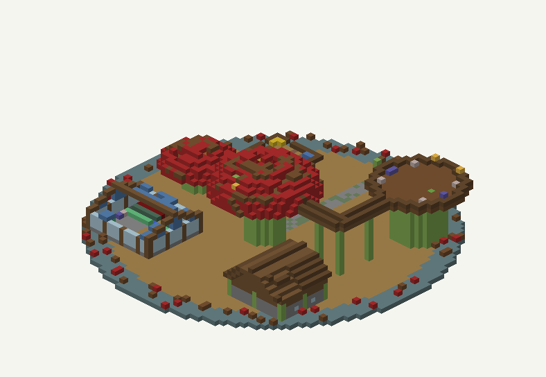
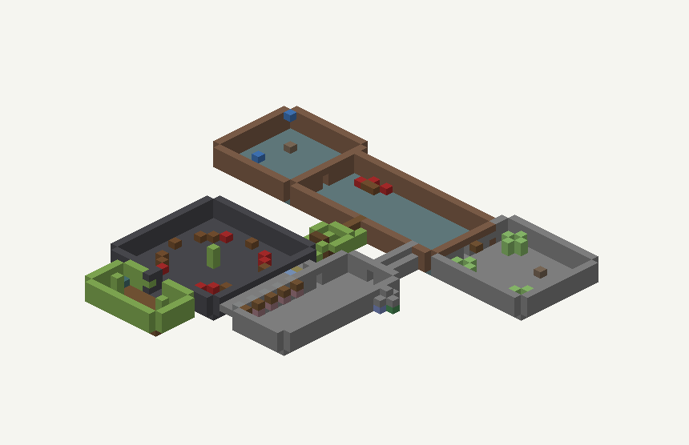

# Mycologist's Laboratory (`heraldia:unicas/laboratorio_micelio`)

An old botanical garden of the mushroom fields, built between and inside **three giant mushrooms**
joined by walkways. Master **Ambrosio**, the mycologist, lived in the cap of the tallest one and searched the spores for a
remedy for every ill; under the mycelium he dug his nurseries and his laboratory. When his last test failed him,
he tried it on himself: he is now **Master Ambrosio, the Spore-Ridden**, and waits in the mother strain chamber with mushrooms
growing in his bones.

It is an original structure: it does not copy any laboratory or mushroom house from another game or mod. It differs from the
wizard's tower (which also has a laboratory and a greenhouse) in that there is no tower and no walls: it is an open garden in which the
buildings are the mushrooms themselves, with life (crops, fauna, nurseries) as its theme, and everything valuable is
underground.

## Biome and placement

- Biome: mushroom fields, plus `#c:is_mushroom` (which in vanilla is exactly that biome: biome mods' mushroom fields
  come in; `biomas.comprobar` checks it). Until now there was no unique structure in it.
- **A very rare biome.** Measured with `/locate biome minecraft:mushroom_fields` from 25 points of a grid of
  ±20,000 blocks (the test's seed): the nearest one was on average 3,600 blocks away (from 960 to 7,347). With the normal
  grid (one random candidate per 4,000-block cell) the candidate would almost never fall on an island. That is why this
  unique structure enables `candidata_en_bioma`: the `heraldia:rejilla` grid has the `bioma` field and each cell's candidate is
  the point of a 128-block mesh (inside the same random_spread window, so two laboratories are never
  closer than the minimum distance) that falls in the biome and has the most neighbors within 64 blocks also in it (the spot
  deepest in the island; 6 of 9 are needed). If the cell has none, there is no candidate. See `GridPlacement`.
- Rarity: `spacing` 250 / `separation` 190 chunks by default (at most one every ~3,000-5,000 blocks), configurable in
  `config/heraldia.json` like the others (`unicas.laboratorio_micelio.activada`,
  `unicas.laboratorio_micelio.separacion_bloques`). It appears on the islands that fall within its cell's window (roughly
  half of them).
- Two rigid pieces joined by a vertical jigsaw under the entrance path (`down_north` → `up_north`, same rotation):
  - `jardin` (64 × 20 × 64): a disc 64 in diameter; its y = 0 layer is the ground (feet go at y = 1).
  - `galerias` (58 × 14 × 56): everything below y = 0. **It fills its whole box**: dirt in the top two
    layers, stone below, and a lining (mycelium, mud bricks and packed mud in the damp galleries, stone brick in the
    laboratory, planks and stem in the corridors, polished deepslate in the mother strain chamber) on every face that
    faces air, so that no springs or lichen appear inside.
- `beard_thin` adaptation: the terrain adjusts to the base of the garden and the galleries stay at their depth, without a crater.
  Mushroom islands are low: if an edge of the disc falls over water, the adjustment should raise the shore under
  it instead of leaving it hanging (deduced from the `Beardifier` code; the look on a real coast has not been seen with
  screenshots). Inside the garden (radius 28) there is explicit air up to 8 blocks above the ground.
- **No giant mushrooms grow in the garden**: the ground is dirt path (giant mushrooms need mycelium,
  dirt or podzol underneath); the pen is dirt path and packed mud. Outside radius 28 the ground is mycelium with
  loose mushrooms: there the island grows back and the garden blends into it. The audit fails if mycelium or dirt is left
  bare inside the garden (except under a roof).

## The garden (feet at y = 1)

Coordinates: x from west to east (0..63), z from north to south (0..63); the entrance is to the north (z = 0). Plans in
[`laboratorio_micelio/planos.txt`](laboratorio_micelio/planos.txt).

- A stone brick **path** from the entrance to the door of the large mushroom, with the sign "The mycologist's garden. Please
  do not step on the mushrooms".
- **Large red mushroom** (center): a hollow stem 7 wide with the **spiral staircase** (`piezas.spiral_stair`)
  from the galleries (feet -11) to the cap (feet 13), with shroomlights in the wall; doors to the garden and to the lower
  walkway. In the **cap**, a dome 19 wide, the **mycologist's house**: bed, bookshelves, table, brewing stand,
  cauldron, barrel and the `estudio` chest. Behind the **red tapestry** of a stem partition, the **hidden alcove** (no other
  exit): lectern and the `alcoba` chest. A door to the east leads to the upper walkway.
- **Small red mushroom** (west): a ladder in the stem and, in the cap, the **assistants' dormitory**
  (two beds, two `ayudantes` chests, a crafting table).
- **Brown mushroom** (northeast): a wide stem with the **spore library** (bookshelves, lectern, a table with candles and the
  `biblioteca` chest, which holds the **Chronicle leaf**) and above it the **herbarium** (pots with samples, flower pots with
  mushrooms and Nether fungi, the `herbario` barrel); a ladder goes up to the **drying room**, the flat cap with a
  railing, composters, barrels and the `secadero` barrel.
- Spruce **walkways** with railings: the lower one (feet 7) from the large stem to the dormitory and the upper one (feet 13) from the large
  cap to the drying room, on stem posts.
- **Greenhouse** (southwest): a frame of stripped logs, glass walls and a gabled glass roof.
  Beds of **nether wart** on soul sand, of **torchflower** and of beetroot, watered by a ditch;
  at the back **sweet berries**, **cocoa** on jungle logs, a **chorus flower** on end stone and **glow
  berries** hanging from the ridge. The `invernadero` chest.
- **Distillery** (southeast): stone brick with stem posts and a gabled spruce roof; a counter with three
  brewing stands, cauldrons, barrels, a copper brewing stand, the `destileria` chest and barrel and the sign "Nothing leaves here
  without its label".
- **Mooshroom pen** (north): a fenced enclosure with a gate, hay, water troughs, the `corral` barrel and **three
  mooshrooms** (two red and one brown).

## The galleries (piece `galerias`)

Upper level (feet at y = -5) and lower level (feet at y = -11), joined by the large mushroom's staircase.

1. **Mushroom nurseries** (upper level): four mud brick beds with mycelium and mushrooms, shroomlights on the ceiling and
   glow lichen; two `criadero` chests and the sign "Humidity: high. Light: just enough".
2. **Laboratory** (west): a table with brewing stands, cauldrons, barrels, the `laboratorio` chest and the sign with **the recipe for
   the cure**: "spore, wart and light. Nothing else". A stem panel in the north wall is the **secret door** (puzzle 2): its
   lever is at floor level, three blocks further on. Behind it, the **strain collection** (hidden room): bookshelves with pots of
   strains, a lectern and the `cepario` chest.
3. **Tripwire corridor** (east): **trap 1**, a tripwire with two arrow dispensers at head
   height.
4. **Abandoned nursery**: rotten beds, cobwebs, the `galeria` chest and a **spider spawner**, in the dark.
5. **Gallery of light** (lower level): mycelium, shroomlights, lichen and the `galeria` chest.
6. **Cocoon room** (west): cobwebs everywhere, the `capullos` chest and a **cave spider
   spawner**, in the dark.
7. **Failed experiments** (east): empty barred cages, the table of test 32 ("on myself"), the
   `experimentos` chest and a **zombie spawner**, in the dark.
8. **Reagent room** (puzzle 1): the west wall has five polished andesite **flasks**, each with its lever
   and its sign: spider eye, red spore, gunpowder, nether wart and glowstone dust. The chiseled stone
   door only opens with **the cure: spore, wart and light** (and nothing else). The correct levers turn off three inverting torches
   that power the pistons' line; the fake ones power it directly with dust, so with
   any fake flask the door stays closed (or closes again). It is the piece of the rune wall and the
   season stones (`piezas.combo_door` with fake levers), already tested on a server, here with five levers.
   To the east, the **reagent cabinet**: a niche with two pressure plates and an arrow dispenser on each side of
   each plate (**trap 2**), and at the back the `reactivos` chest.
9. **Mother strain chamber** (hidden): six high, polished deepslate, a **giant mushroom growing
   underground** with shroomlights under its cap, a ring of mushrooms, brown tapestries and the `cepa` chest. It is patrolled by the
   **guardian**, **Master Ambrosio, the Spore-Ridden**: a bogged (the mushrooms already grow on it) with a red
   mushroom hat, 50 health and armor 4.
10. **Treasure chamber**, south of the mother strain: the **premium** chest, a gold block with candles, a barrel, pots and
    stem posts.

## Player route

Entrance → garden (free: greenhouse, distillery, pen) → spore library, herbarium and drying room through the brown
mushroom → door of the large mushroom → stairs up to the lower walkway (dormitory) or the mycologist's house (tapestry →
alcove; upper walkway → drying room), or down → nurseries → laboratory (lever → strain collection), tripwire corridor →
abandoned nursery. Further down → gallery of light → cocoons, failed experiments, reagent room (cabinet with
the trap) → the cure → mother strain chamber → treasure. Everything has a way back to the entrance without jumps (the
audit checks it; you get out of the greenhouse ditch by swimming).

## Puzzles and traps (everything at rest and consistent when generated)

- **Puzzle 1, the reagents** (`piezas.combo_door` with three levers and two fake ones): extended sticky pistons holding
  two blocks of chiseled stone; the line of dust runs inside the wall (four thick: levers, torches or the fake ones' dust,
  door and pistons with the line, and the face of the mother strain chamber). The 32 combinations are tried.
- **Puzzle 2, the strain collection panel** (`piezas.lever_door`): two stem blocks at the back of a niche; the lever turns off the
  inverting torch and the pistons pull them in. Pistons and torch stay inside the wall.
- **Trap 1**: a taut tripwire between two hooks with a dispenser above each hook (`piezas.tripwire_trap`).
- **Trap 2**: two stone plates in the reagent cabinet, each with a dispenser on each side
  (`piezas.plate_trap`).

## Enemies and entities

- **3 spawners**, all underground and in the dark (block light 0 within a radius of 4; the shroomlights of the
  nurseries and of the gallery of light stay more than 15 light steps away): spiders (abandoned nursery), cave spiders
  (cocoons) and zombies (failed experiments). In mushroom fields monsters do not spawn naturally, but
  spawners do not depend on the biome: they only need darkness.
- **Guardian**: Master Ambrosio (the only one with the `heraldia_guardian` tag; it drops its trophy if a player kills it, and its
  usual bogged loot; the hat does not drop). A bogged and not a zombie because the zombies
  of a template go through `finalizeSpawn` and could come out as babies.
- **Fauna**: three mooshrooms in the pen (persistent). In total, **4 entities** per structure.

## Chests (22) and loot

Richer the more hidden they are; each table has an extra `solo_sin_lootr` pool. Potions, rare ingredients and
books.

| Table | Where | Contents |
|---|---|---|
| `ayudantes` (2) | dormitory | mushrooms, stew, bread, bottles, string, candles, paper; extra: emerald, nuggets, House Stew |
| `estudio` | the mycologist's house | books, paper, ink, bottles, spider eyes, night vision, Strain Notebook; extra: enchanted book, the Mycologist's Magnifier |
| `alcoba` | hidden alcove | gold, emeralds, Strain Notebook, Mycelium Elixir, enchanted book, regeneration; extra: diamond, golden apple, Strain Staff |
| `biblioteca` | spore library | books, paper, bottles, mushrooms and Nether fungi, Strain Notebook **and the Chronicle leaf**; extra: enchanted book |
| `herbario` (barrel) | herbarium | mushrooms, fern, moss, lichen, glow berries, fungi; extra: wart, Golden Spore |
| `secadero` (barrel) | drying room | heaps of mushrooms, dried kelp, bone meal, sugar; extra: glowstone |
| `invernadero` | greenhouse | wart, torchflower seeds, pitcher pod, berries, cocoa, chorus; extra: glistering melon, golden carrot |
| `destileria` (chest and barrel) | distillery | bottles, wart, sugar, redstone, glowstone, gunpowder, potions; extra: blaze powder, magma cream, the Mycologist's Tonic |
| `corral` (barrel) | pen | wheat, bowls, leather, bucket, lead; extra: saddle |
| `criadero` (2) | nurseries | mushrooms, mycelium, lichen, bone meal, iron nuggets; extra: iron, wart |
| `laboratorio` | laboratory | bottles, spider eyes, redstone, rabbit's foot, phantom membrane, potions; extra: the Mycologist's Tonic, ghast tear |
| `galeria` (2) | abandoned nursery, gallery of light | string, spider eyes, bones, coal, glow berries; extra: iron, golden apple |
| `cepario` | hidden strain collection | enchanted books, Strain Notebook, Golden Spore, ghast tear, lapis lazuli; extra: diamonds, "mall" disc |
| `capullos` | cocoon room | string, cobwebs, fermented spider eyes; extra: ingots, splash potion of poison |
| `experimentos` | failed experiments | rotten flesh, splash weakness, strength, golden carrot; extra: diamond, Cure-All |
| `reactivos` | reagent cabinet (trap) | wart, blaze, glowstone, magma cream, ghast tear, dragon's breath; extra: diamonds, emerald block |
| `cepa` | mother strain chamber | mushroom blocks, shroomlights, lapis lazuli, Pruning Shears, turtle master; extra: diamonds |
| `premium` | treasure chamber | 90 %: Golden Spore, Wide-Brimmed Hat, the Mycologist's Magnifier, Cure-All, Mycelium Elixir, armor trims (host, shaper, flow), discs ("mall", "strad", "far"), gold, emeralds, enchanted book; 10 %: an enchanted diamond pickaxe or chestplate, an enchanted golden apple or a totem |

No netherite or elytra.

## Trophy and Chronicle

- **Trophy**: *Master Ambrosio's Shears* (rare shears, Efficiency 2, Unbreaking 2): "They pruned the strains in his
  garden. The spores would not be pruned".
- **Leaf** (`biblioteca` chest): Ysolda reaches an island of giant mushrooms and meets Master Ambrosio, who lives in
  the cap of a mushroom as tall as a tower and searches the spores for a remedy for every ill; he swears to keep her
  leaf among the flasks of his spore library. They say that, when his last test failed him, he tried it on himself.
  The clue with which the Stranded galleon's leaf points to it: "an island of giant mushrooms, where a sage grew
  spores under a red cap". Its own points to the Haunted mansion.

## State of conservation

Visible surface damaged: **17 %** (computed over the garden's blocks with a face to the outside air, without the walked
floor or the loose mushrooms: the hand-made ruin plus what is expected from the processor). Hand-made ruin: holes in the
crowns of the two red caps and **brown rot stains** on them, the **stem's skin peeled off** in patches
(the porous flesh shows: the stem block with every face "skinless"), fallen panes from the greenhouse
roof, the caved-in corner of the distillery roof, fallen stretches of railing on the walkways and the
drying room, and the broken pen fence. Processor: stone brick → cracked (18 %) or mossy (15 %) and broken
panes (30 %). Nothing that holds up a mechanism changes its solidity.

## Audit (a condition for generating)

`auditoria.py` fails the build if: the redstone is not in its stable state; any of the 32 combinations of the
reagents opens without being the correct one (or the correct one does not open); the lever does not open the strain collection; the wire or the plates do not fire (or
a dispenser has a signal at rest); something hidden (strain collection, mother strain chamber, treasure) can be reached without
solving the puzzles or cannot be reached by solving them; the alcove cannot be reached through the tapestry; there are chests, spawners or
levers out of reach, mooshrooms outside their pen, doors without an exit, stairs without headroom, cells without a way back
to the entrance (strict walk without falls, swimming in the water), spawners with light, loose blocks, natural rock in
sight underground, bare fertile ground in the garden, the number of chests falls outside 15-25 or the damaged surface outside
15-20 %. The shared checks also run (`lint.support_issues`, `access_issues`, `door_pair_issues`,
`stair_headroom_issues`) over the whole build.

## Performance

- Generation: two templates (about 26,200 + 45,500 blocks, on the order of the Sanctuary) with a rule processor and without
  a custom Java structure. Generating the module takes about 3.5 s in Python. `/place structure` of the whole structure
  took 694 ms on the test server (printed by `prueba_servidor.py`).
- Placement: the biome search of each cell took 5-7 ms (about 600 samples of the biome noise, without loading
  chunks), only once per cell and cached; in `isPlacementChunk` only the mesh's chunks (1 in 64) get to
  query it. `/locate` from 0,0 found the laboratory at 1,168, -9,168 (9,242 blocks away) in 444 ms, and when
  those chunks loaded the structure was really generated (its guardian was there, in mushroom fields). The island nearest to
  0,0 (about 5,800 blocks away) falls outside its cell's window: that is why not every island has a laboratory.
- Entities: 4 (the guardian and three mooshrooms). 3 spawners with the vanilla radius and limit. Nothing per tick.

## Tests

- `python3 tools/gen/unicas/laboratorio_micelio/planos.py` → plans by level and renders in
  `docs/unicas/laboratorio_micelio/`.
- `python3 tools/gen/unicas/laboratorio_micelio/prueba_servidor.py --jar build/libs/heraldia-<version>.jar --work "$PWD/build/smoke"`:
  `/locate` from 0,0 (distance and time), loads that spot and checks that it is mushroom fields and that the
  laboratory has really been generated (its guardian is there); places the structure (measures the time and counts entities)
  and the templates unrotated to check chests, spawners, crops and water, and operate the reagents (also with
  a fake flask), the strain collection panel, the tripwire and the cabinet's plates. It is in the CI matrix.

## Renders

