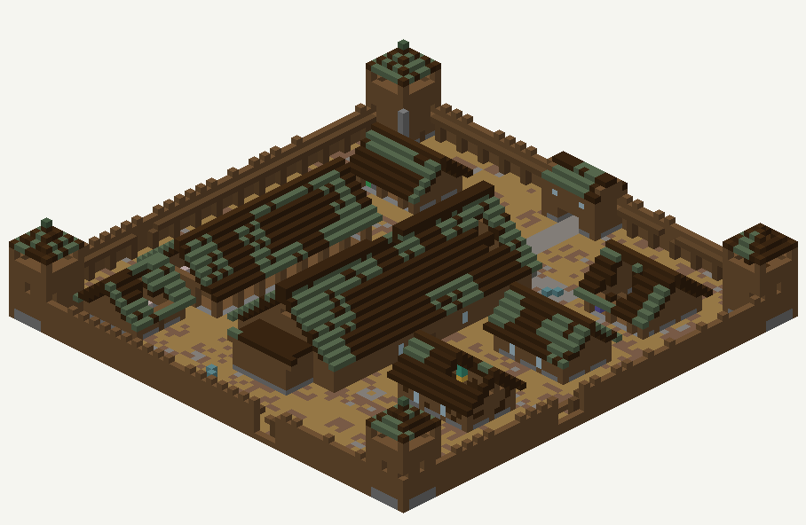
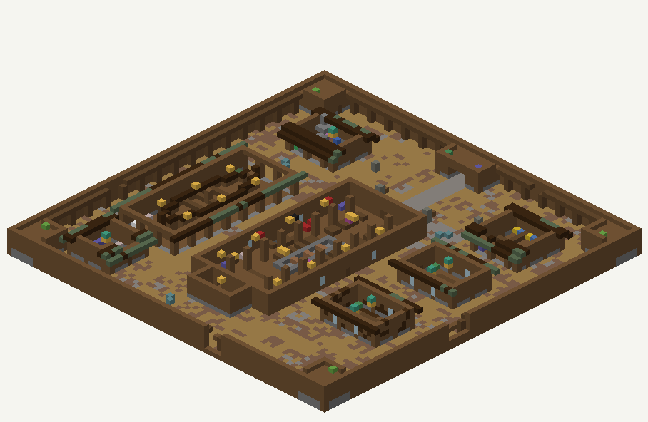
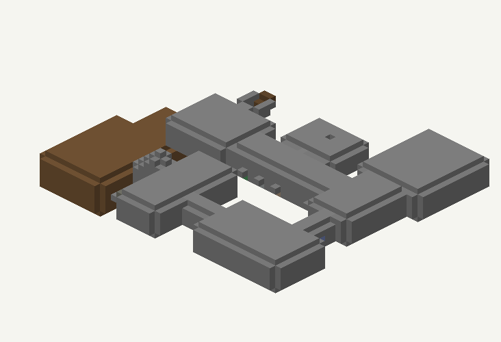

# Salón del Jarl (`heraldia:unicas/salon_jarl`)

Asentamiento nórdico fortificado en un claro de la taiga: una empalizada de troncos con adarve y cuatro torres
encierra la casa larga del jarl Ulfgrim y los talleres de su gente. Bajo la casa larga está el túmulo de los reyes del
salón, donde el jarl, que juró no soltar nunca el pliego de Ysolda, sigue en pie: el **Insepulto**.

Es una estructura original: no copia ningún asentamiento de otro juego o mod. Se distingue de la aldea de la familia
taiga (estilo nórdico de casas largas) en que es un recinto cerrado y defendido, con una sola casa larga de gran
tamaño, talleres especializados, ruina y un subsuelo con puzles, trampas, generadores y guardián.

## Bioma y colocación

- Biomas: taiga, taiga ancestral de pinos y taiga ancestral de abetos (lista vanilla, sin etiquetas `#c:`: `#c:is_taiga`
  mete la taiga nevada, que es de la fortaleza de hielo; `biomas.comprobar` lo verifica).
- Rareza: `spacing` 250 / `separation` 190 chunks (una cada ~3.000-5.000 bloques), configurable en
  `config/heraldia.json` como las demás (`unicas.salon_jarl.activada`, `unicas.salon_jarl.separacion_bloques`).
- Dos piezas rígidas unidas por un jigsaw vertical bajo la casa larga (`down_north` → `up_north`, misma rotación):
  - `salon` (74 × 18 × 74): recinto, casa larga y talleres; su capa y = 0 es el suelo (los pies van a y = 1).
  - `tumulo` (49 × 15 × 42): todo lo que queda por debajo de y = 0. **Rellena toda su caja**: tierra en las dos capas
    de arriba, piedra debajo, y forro de piedra labrada (adoquín, ladrillo de piedra o madera) en toda cara que da al
    aire, para que no salgan manantiales ni liquen dentro.
- Adaptación `beard_thin`: el terreno se ajusta a la base del recinto (y = 0) y el túmulo queda a su profundidad, sin
  cráter (ver «Sótanos sin cráter» en `docs/APRENDIZAJES.md`). En la taiga ancestral, con pendientes y peñascos, el
  claro se allana bajo la empalizada; dentro hay aire explícito hasta 6 bloques sobre el patio para que ninguna ladera
  asome entre las casas.
- Suelo del patio: tierra de camino, grava y barro compacto. No hay hierba, tierra, podsol ni piedra natural a la vista
  en el recinto, así que la decoración de la taiga (abetos, helechos, peñascos de piedra musgosa) no nace dentro.
- Sin cobertizo junto al agua: el jigsaw no detecta ríos ni lagos (haría falta Java, como el faro o el galeón). En su
  lugar, el **astillero** guarda un barco largo a medio construir sobre su grada, en seco.

## Superficie (pies a y = 1)

Coordenadas: x de oeste a este (0..73), z de norte a sur (0..73); la puerta está al norte (z = 0).

- **Empalizada** de troncos de abeto de 6-7 de alto con las puntas alternas, y **adarve** de tablones (pies a 5) por
  dentro de todo el perímetro, sobre pies derechos.
- **Cuatro torres** de 7 × 7 en las esquinas: planta baja con puerta al patio, sala a la altura del adarve (con salida a
  los dos lienzos), atalaya abierta (pies a 10) y tejado a cuatro aguas; se sube por una escalera de mano. Saeteras en
  las caras exteriores. La del noroeste guarda un cofre en la atalaya; la del noreste tiene el tejado hundido.
- **Puerta** (x 32..41): túnel de 4 de ancho con jambas de troncos, tapices y faroles, y encima la sala de guardia
  (cofre y tonel), con salida al adarve por los dos lados y tejado a dos aguas.
- **Casa larga** (x 28..45, z 22..58): muros de troncos tumbados entre postes, zócalo de adoquín y cubierta de roble
  oscuro a dos aguas (cumbrera a y = 16) con lucernario de humos sobre el hogar. Dentro: dos filas de pies derechos con
  tirantes, **hogar alargado** con hogueras, dos **mesas largas** con bancos (respaldo hacia fuera) y pasos entre
  ellas, camas, telar, cofres y toneles en las naves laterales, tapices rojos y negros, y al fondo el **estrado** con
  **dos tronos** de respaldo alto. Puerta doble al norte y puertas laterales al astillero y a las casas de los guerreros.
  En la nave oeste, la **escalera al túmulo** (7 peldaños, con barandilla).
- **Alcoba del jarl** (sala oculta, x 32..41, z 58..63): adosada al hastial sur, sin puerta al exterior. Se entra por
  detrás del **tapiz negro** del estrado (a la izquierda de los tronos): un paso de 1 × 2 que el tapiz tapa. Cama, cofre
  `jarl`, atril, tonel y tapiz.
- **Herrería** (noroeste): fragua con caldero de lava, campana y chimenea, alto horno, yunque, mesa de herrería,
  afilador, caldero de agua, cofre y tonel. Abierta al sur.
- **Establos** (noreste): tres cuadras con heno, comederos de agua y portillos; cofre y tonel. Tejado roto en parte.
- **Astillero** (oeste): cobertizo largo abierto al patio con un **barco largo** a medio hacer sobre su grada (quilla,
  casco de tablones, roda y codaste altos, bancos de remo y mástil sin vela), banco del carpintero, tonel con botín,
  afilador, telar y lana para la vela.
- **Casas de los guerreros** (este): dos casas de 13 × 9 con cuatro camas, mesa con bancos, cofre y tonel. La del sur
  ardió: tablones carbonizados, cubierta hundida sobre su extremo este y una hoguera apagada entre los escombros.
- **Despensa** (suroeste): toneles, heno, compostador y un cofre y un tonel con víveres; parte de la cubierta caída.
- **Piedras rúnicas**: dos a los lados de la explanada ante la casa larga (la del oeste lleva la **adivinanza** del muro
  de las runas: «Despierta al cuervo y al lobo; que duerman la serpiente y el oso»; la del este, «Aquí reina Ulfgrim,
  jarl de la taiga») y dos sueltas en el patio.

## Túmulo de los reyes (pieza `tumulo`)

Nivel alto (pies a y = -6, salas de 4 de alto) y nivel bajo (pies a y = -12). Planos en
[`salon_jarl/planos.txt`](salon_jarl/planos.txt).

1. **Vestíbulo de los antepasados**: llegada de la escalera; dos guerreros de piedra (soportes de armadura con yelmo,
   cota y hacha de piedra), tapices, faroles de almas y un cartel: «Aquí duermen los reyes del salón. Que nadie despierte
   al jarl».
2. **Galería de los reyes**: 17 bloques con nichos funerarios en los dos muros (calaveras, huesos) y el cofre de un rey
   menor (`tumba`). **Generador de zombis**. Uno de los nichos del norte está sellado: es la **puerta secreta** (puzle
   2) a la **cámara del escaldo** (sala oculta: estanterías, atril, bloque musical, cofre `escaldo`). Su palanca está a
   ras de suelo junto al pie del muro, tres bloques más allá.
3. **Sala de los ecos**: cruce con telarañas y **generador de arañas**.
4. **Osario** (al norte): pilas de huesos y calaveras, cofre `osario` y **generador de esqueletos**.
5. **Pasillo del cable trampa** (al sur): **trampa 1**, cable trampa con dos dispensadores de flechas a la altura de la
   cabeza (como en el templo de la jungla).
6. **Sala de las ofrendas**: vasijas, velas y tapices; el cofre `ofrendas` guarda el **pliego de la Crónica**. En el
   extremo oeste, sobre un altar, el cofre de la **codicia**, con dos placas de presión delante y dinamita debajo
   (**trampa 2**, como en el templo del desierto).
7. **Sala de las runas** (puzle 1): el muro oeste tiene cuatro **piedras rúnicas** de toba cincelada, cada una con su
   palanca y su nombre: Ormr, la serpiente; Hrafn, el cuervo; Björn, el oso; Ulfr, el lobo. La puerta de piedra se abre
   solo con **el cuervo y el lobo despiertos y la serpiente y el oso dormidos** (la adivinanza está en la piedra rúnica
   del patio). Las palancas correctas apagan dos antorchas inversoras que alimentan la línea de los pistones; las falsas
   la alimentan directamente con polvo, así que con cualquier runa falsa despierta la puerta se queda cerrada (o se
   vuelve a cerrar).
8. **Escalera estrecha** (seis peldaños) al nivel bajo y **cámara del jarl**: cámara funeraria de madera, como las de los
   barcos enterrados, con postes, tapices, vasijas y el túmulo de piedra **abierto y vacío**: el **guardián**, el
   **jarl Ulfgrim, el Insepulto** (zombi, 60 de vida, armadura 4, hacha de hierro, yelmo de hierro y cota de malla; sin
   refuerzos, sin coger botín y sin romper puertas), ronda la sala.
9. **Cámara del tesoro**, al norte de la del jarl: cofre **premium**, bloque de oro con velas, tonel y vasijas.

## Recorrido del jugador

Puerta → patio (libre: torres y adarve, herrería, establos, astillero, casas, despensa) → casa larga → tapiz del estrado
→ alcoba del jarl. Escalera de la nave oeste → vestíbulo → galería de los reyes (palanca → cámara del escaldo) → sala de
los ecos → osario (callejón) o pasillo del cable trampa → sala de las ofrendas → sala de las runas → combinación →
escalera → cámara del jarl → tesoro. Todo tiene vuelta a la entrada sin saltos (lo comprueba la auditoría).

## Puzles y trampas (todo en reposo y coherente al generarse)

- **Puzle 1, muro de las runas** (`piezas.combo_door` con dos palancas y dos falsas): pistones pegajosos extendidos
  sujetando dos bloques de toba pulida; la línea de polvo va dentro del muro (cuatro de grueso: palancas, antorchas o
  polvo de las falsas, puerta y pistones con la línea, y la cara de detrás). Se prueban las 16 combinaciones.
- **Puzle 2, puerta secreta del escaldo** (`piezas.lever_door`): nicho sellado con ladrillo cincelado; la palanca apaga la
  antorcha inversora y los pistones recogen la puerta. Los pistones y la antorcha quedan dentro del muro de dos de grueso.
- **Trampa 1**: cable trampa tenso entre dos ganchos con un dispensador encima de cada gancho.
- **Trampa 2**: dos placas de piedra delante del cofre de la codicia con dinamita dos bloques por debajo.

## Enemigos y entidades

- **3 generadores**, todos en el túmulo y a oscuras (luz de bloque 0 en un radio de 4): zombis (galería), arañas (sala
  de los ecos) y esqueletos (osario).
- **Guardián**: el jarl Ulfgrim (único con la etiqueta `heraldia_guardian`; suelta su trofeo si lo mata un jugador).
- Dos soportes de armadura en el vestíbulo. Sin aldeanos, gólems ni animales: el salón está abandonado.
- En total, **3 entidades** por estructura.

## Cofres (18) y botín

Más ricos cuanto más escondidos; cada tabla tiene un grupo extra `solo_sin_lootr`.

| Tabla | Dónde | Contenido |
|---|---|---|
| `atalaya` (2) | torre noroeste, sala de guardia | flechas, antorchas, pan, pedernal, arco gastado, catalejo |
| `herreria` | herrería | hierro, carbón, herramientas gastadas, cadenas; extra: Martillo del herrero, algún diamante |
| `establo` | establos | cuero, trigo, riendas, heno, silla; extra: armaduras de caballo |
| `astillero` (tonel) | astillero | tablones, palos, cuerda, lana, bote de abeto; extra: Remo del barco largo, mapa, brújula |
| `guerreros` (2) | casas de los guerreros | flechas, armadura de cuero, hacha de piedra, escudo; extra: hacha de hierro encantada |
| `despensa` (cofre y tonel) | despensa | pan, trigo, pescado, bayas, miel; extra: tarta, manzana dorada |
| `salon` (2) | naves de la casa larga | comida, lana, cuero, flechas; extra: pepitas, esmeralda |
| `jarl` | alcoba oculta | oro, esmeraldas, cuerno de cabra, Anillo del juramento, Hidromiel del jarl, libro encantado |
| `tumba` | galería de los reyes | huesos, pepitas, espada gastada; extra: yelmo de oro encantado |
| `osario` | osario | huesos, flechas, calavera; extra: arco encantado, frascos de experiencia |
| `escaldo` | cámara oculta del escaldo | libros, papel, plumas, Saga de Ulfgrim; extra: libro encantado, disco «far», cuerno |
| `ofrendas` | sala de las ofrendas | oro, esmeraldas, amatista, Piedra rúnica tallada **y el pliego de la Crónica** |
| `codicia` | altar de la codicia (trampa) | oro y esmeraldas a montones; extra: diamantes, bloque de oro |
| `premium` | cámara del tesoro | 90 %: Hacha de la incursión, Cuerno de la asamblea, Escudo del salón, adornos de armadura (costa, salvaje, costilla), discos, oro, esmeraldas, libro encantado; 10 %: hacha o peto de diamante encantados, manzana dorada encantada o tótem |

Nada de netherita ni élitros.

## Trofeo y Crónica

- **Trofeo**: *Rompeescudos de Ulfgrim* (hacha de hierro rara, filo 2, irrompibilidad 2): «Hendió cien escudos en su
  última incursión. El jarl no lo soltó ni muerto».
- **Pliego** (cofre `ofrendas`): Ysolda llega al salón, el jarl la escucha junto al hogar y jura por sus antepasados
  guardar el pliego; lo bajan al túmulo de sus reyes, entre las ofrendas, y él promete que ni la muerte se lo quitará.
  Pista con la que lo señala el pliego del Templo-pirámide: «la taiga, donde un jarl insepulto guarda su salón tras una
  empalizada». El suyo señala la Torre de mago.

## Estado de conservación

Superficie a la vista dañada: **16 %** (calculado sobre los bloques del salón con una cara al aire exterior: la ruina
hecha a mano más lo que se espera del procesador). Ruina a mano: brechas en la empalizada este y sur con troncos caídos
hacia dentro, puntas caídas y troncos descortezados en manchas, tramos del adarve rotos, tejado hundido de la torre
noreste, la casa de guerreros quemada, huecos en las cubiertas de la despensa, los establos y la casa larga (con escombro
debajo) y manchas de musgo en las cubiertas. Procesador: adoquín → musgoso (35 %), ladrillo de piedra → agrietado
(12 %) o musgoso (8 %) y cristales rotos (30 %). Nada que sostenga un mecanismo cambia de solidez.

## Auditoría (condición para generar)

`auditoria.py` falla la compilación si: la redstone no está en su estado estable; alguna de las 16 combinaciones del
muro de las runas abre sin ser la buena (o la buena no abre); la palanca no abre la puerta del escaldo; el cable o las
placas no disparan; algo de lo oculto (cámara del escaldo, escalera inferior, cámara del jarl, tesoro) se alcanza sin
resolver los puzles o no se alcanza resolviéndolos; la alcoba no se alcanza por el tapiz; hay cofres, generadores o
palancas inalcanzables, puertas sin salida, escaleras sin altura libre, celdas sin vuelta a la entrada (recorrido
estricto sin caídas), generadores con luz, bloques sueltos, roca natural a la vista en la cripta, el número de cofres
sale de 15-25 o la superficie dañada de 15-20 %. Además pasan las comprobaciones comunes (`lint.support_issues`,
`access_issues`, `door_pair_issues`, `stair_headroom_issues`) sobre la obra entera.

## Rendimiento

- Generación: dos plantillas (45.400 + 30.900 bloques, menos que la fortaleza de hielo) con un procesador de reglas y sin
  Java propio. Tiempo de `/place structure` medido en el servidor de prueba: ver el PR (lo imprime
  `prueba_servidor.py`).
- Entidades: 3 (guardián y dos soportes de armadura). 3 generadores con el radio y límite vanilla. Nada por tick.

## Pruebas

- `python3 tools/gen/unicas/salon_jarl/planos.py` → planos por nivel y renders en `docs/unicas/salon_jarl/`.
- `python3 tools/gen/unicas/salon_jarl/prueba_servidor.py --jar build/libs/heraldia-<versión>.jar --work "$PWD/build/smoke"`:
  coloca la estructura (mide el tiempo y cuenta entidades), y las plantillas sin girar para accionar las runas (también
  con una runa falsa), la puerta del escaldo, el cable trampa y las placas de la dinamita. Está en la matriz de la CI.

## Renders

