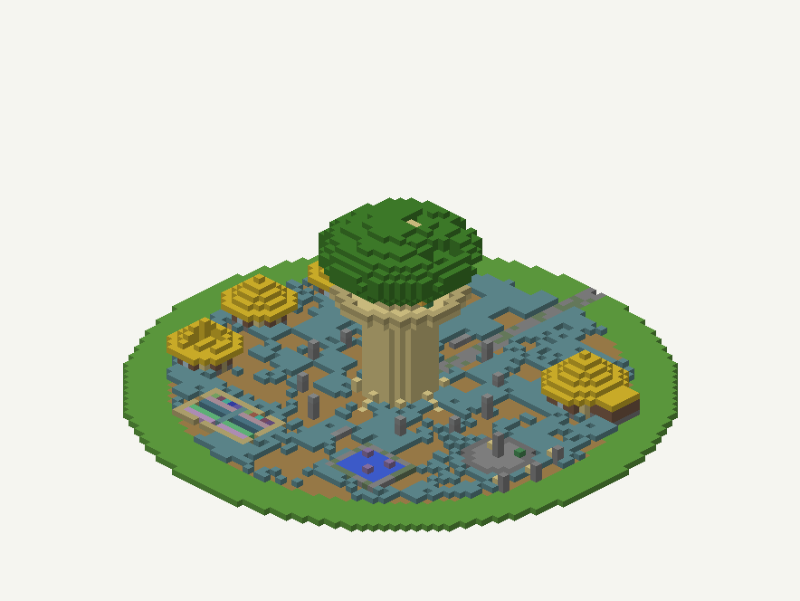
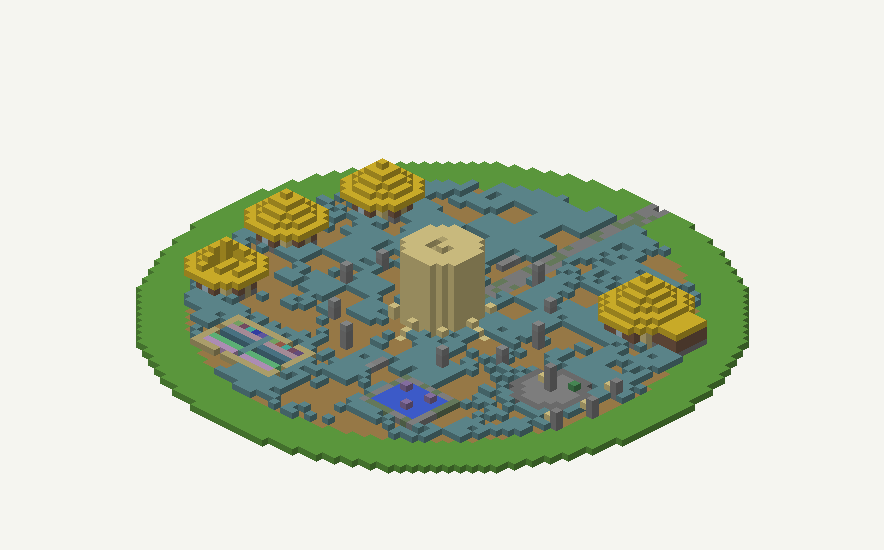
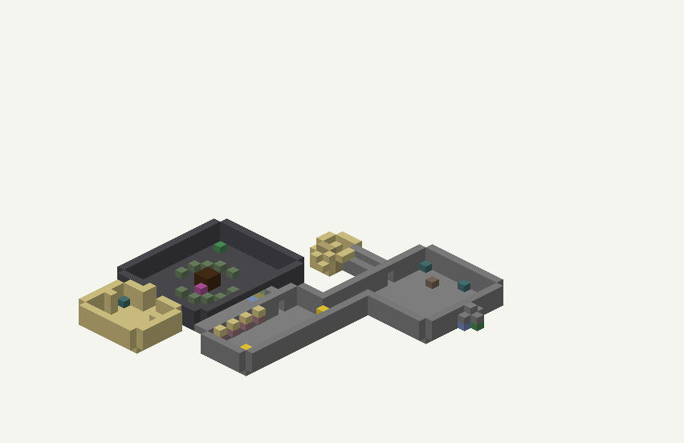

# Santuario druídico (`heraldia:unicas/santuario`)

Un claro del bosque de abedules rodeado de menhires, con un **abedul sagrado** enorme en medio: su tronco hueco guarda
una escalera de caracol que sube hasta una plataforma bajo la copa y baja a las raíces, donde los druidas excavaron su
biblioteca, su herbolario y el osario de sus fieles. El árbol se está secando: el archidruida **Cadoc**, que juró por
sus raíces guardar el pliego de Ysolda, pactó con poderes oscuros para salvarlo y ahora espera, **el Marchito**, en la
cámara del rito, junto al tocón negro del primer árbol.

Es una estructura original: no copia ningún santuario de otro juego o mod. Se distingue de la catedral (bosque y bosque
de flores) y de la aldea de la familia bosque en que no hay muros: es un claro abierto, con cabañas redondas pequeñas y
un único árbol monumental, y todo lo valioso está bajo tierra.

## Bioma y colocación

- Biomas: bosque de abedules y bosque de abedules antiguo, más `#c:is_birch_forest` (que en vanilla son exactamente
  esos dos: entran los bosques de abedules de mods de biomas; `biomas.comprobar` lo verifica). Hasta ahora no había
  ninguna única en ellos.
- Rareza: `spacing` 250 / `separation` 190 chunks (una cada ~3.000-5.000 bloques), configurable en
  `config/heraldia.json` como las demás (`unicas.santuario.activada`, `unicas.santuario.separacion_bloques`).
- Dos piezas rígidas unidas por un jigsaw vertical bajo el camino de entrada (`down_north` → `up_north`, misma rotación):
  - `claro` (72 × 32 × 72): un disco de 72 de diámetro; su capa y = 0 es el suelo (los pies van a y = 1).
  - `raices` (49 × 14 × 63): todo lo que queda por debajo de y = 0. **Rellena toda su caja**: tierra en las dos capas de
    arriba, piedra debajo, y forro (tierra enraizada y madera de abedul en la sala de las raíces, tablones en la
    biblioteca, adobe en el herbolario, piedra labrada o pizarra abismal labrada en lo demás) en toda cara que da al
    aire, para que no salgan manantiales ni liquen dentro.
- Adaptación `beard_thin`: el terreno se ajusta a la base del claro (y = 0) y las raíces quedan a su profundidad, sin
  cráter (ver «Sótanos sin cráter» en `docs/APRENDIZAJES.md`). Dentro del claro (radio 30) hay aire explícito hasta 6
  bloques sobre el suelo, para que ninguna ladera asome entre las cabañas.
- **Nada nace en el claro**: el suelo pisado es tierra de camino con alfombras de musgo en manchas (los árboles, la hierba
  y las flores del bosque no se colocan sobre ella); los bancales y el arriate del huerto llevan un cultivo o una flor en
  cada casilla, así que tampoco cabe un árbol. Fuera del radio 30 el suelo es hierba: ahí el bosque vuelve a crecer y el
  claro se funde con él. La auditoría falla si queda tierra fértil descubierta dentro del claro.

## El claro (pies a y = 1)

Coordenadas: x de oeste a este (0..71), z de norte a sur (0..71); la entrada está al norte (z = 0). El árbol está en el
centro (36, 36). Planos en [`santuario/planos.txt`](santuario/planos.txt).

- **Camino** de adoquín musgoso de la entrada a la puerta del árbol.
- **Abedul sagrado**: tronco de troncos de abedul de 9 de ancho (radio 4,5) que se estrecha en la copa, con raíces que
  se abren a su pie (ninguna al norte, donde está la puerta) y corteza desprendida en manchas. Dentro, la **escalera de
  caracol** (`piezas.spiral_stair`) va de las raíces (pies -11) a la copa (pies 19), con setas luminosas en la pared del
  hueco. Puerta al claro y puerta a la **plataforma de la copa**: un anillo de tablones con barandilla (que no deja
  huecos en diagonal) sobre ménsulas de tronco, faroles colgados de la copa y el cofre `copa`. La **copa** es una cúpula
  de hojas persistentes (no se secan) de 21 de ancho con ramas por dentro; tiene claros donde el árbol se marchita.
- **Círculo de piedras**: doce menhires de piedra y andesita alrededor del árbol (radio 13); dos se han caído.
- **Cabañas de los druidas** (tres, al oeste): redondas, zócalo de adoquín, muros de adobe con postes de abedul
  descortezado, ventanas en los tramos rectos y cubierta cónica de paja maciza. Cama, cofre `cabana`, tonel, maceta y
  algo del oficio de cada uno (mesa de trabajo, caldero, compostador). La del sur tiene la cubierta hundida en parte.
- **Cabaña del archidruida** (noreste): más grande, con cama, cofre, atril y alambique. Tras el **tapiz verde** del muro
  este, un paso de 1 × 2 lleva a su **alcoba oculta** (sin otra salida): cofre `archidruida`.
- **Huerto de hierbas** (suroeste): cercado de abedul con portillo, bancales de trigo, zanahoria, remolacha y patata
  regados por dos acequias, un arriate de flores (allium, aciano, lirio de los valles...), dos **colmenas** con miel y el
  tonel `jardin`. Sendero central.
- **Estanque de piedra** (sureste): pila elevada un bloque, con nenúfares.
- **Observatorio de piedras alineadas** (este): estrado redondo con un **gnomon** y, al este, tres piedras hacia las
  salidas del sol: «Sol de verano» (noreste), «Sol de los equinoccios» (este) y «Sol de invierno» (sureste). El gnomon
  lleva la **adivinanza**: «Enciende los solsticios; deja a oscuras los equinoccios». Cofre `observatorio`.

## Las raíces (pieza `raices`)

Nivel alto (pies a y = -5) y nivel bajo (pies a y = -11), los dos unidos por la escalera del árbol.

1. **Sala de las raíces** (nivel alto, al norte del árbol): pilares de madera, raíces colgantes y telarañas; a oscuras,
   con un **generador de arañas** y el cofre `raices`.
2. **Biblioteca** (oeste): estanterías, mesa de lectura, atril y el cofre `biblioteca`, que guarda el **pliego de la
   Crónica**. Un tramo de estantería del muro norte es la **puerta secreta** (puzle 2): su palanca está a ras de suelo,
   tres bloques más allá. Detrás, el **archivo** (sala oculta): estanterías, atril y el cofre `secreto`.
3. **Herbolario** (este): alambiques, calderos, compostador, toneles con macetas, una mesa larga de secar hierbas, el
   cofre y el tonel `herbolario`.
4. **Pasillo del cable trampa** (norte): **trampa 1**, cable trampa con dos dispensadores de flechas a la altura de la
   cabeza.
5. **Osario de los fieles**: pilas de huesos y calaveras, el cofre `osario`, un cartel («Los fieles descansan al pie del
   árbol») y un **generador de zombis**.
6. **Sala de las ofrendas** (nivel bajo, al este del árbol): vasijas y velas, un **generador de esqueletos**, el cofre
   `raices` y, al fondo de un nicho del muro este, el cofre de las **ofrendas** con dos placas de presión delante y un
   dispensador de flechas a cada lado de cada placa (**trampa 2**).
7. **Cámara del sol** (puzle 1): el muro oeste tiene cuatro **piedras de las estaciones** de ladrillo cincelado, cada
   una con su palanca y su cartel: primavera, verano, otoño e invierno. La puerta de piedra musgosa se abre solo con
   **los solsticios encendidos (verano e invierno) y los equinoccios apagados (primavera y otoño)**: la adivinanza está
   en el gnomon del claro y las piedras alineadas lo explican. Las palancas buenas apagan dos antorchas inversoras que
   alimentan la línea de los pistones; las falsas la alimentan directamente con polvo, así que con cualquier piedra falsa
   encendida la puerta se queda cerrada (o se vuelve a cerrar). Es la misma pieza que el muro de las runas del Salón del
   Jarl (`piezas.combo_door` con dos palancas falsas), ya probada en servidor.
8. **Cámara del rito** (oculta): pizarra abismal labrada, tapices negros, un círculo de piedras musgosas alrededor del
   **tocón negro** del primer árbol y velas encendidas. La ronda el **guardián**, el **archidruida Cadoc, el Marchito**
   (evocador, 50 de vida, armadura 4; sus vejaciones son su única escolta). Cofre `ritual`.
9. **Cámara del tesoro**, al sur de la del rito: cofre **premium**, bloque de oro con velas, tonel, vasijas y postes.

## Recorrido del jugador

Entrada → claro (libre: cabañas, huerto, estanque, observatorio, círculo) → puerta del árbol → escalera arriba hasta la
plataforma de la copa, o abajo → sala de las raíces → biblioteca (palanca → archivo), herbolario, pasillo del cable
trampa → osario. Más abajo → sala de las ofrendas (nicho con la trampa) → cámara del sol → combinación → cámara del rito →
tesoro. En la cabaña del archidruida, tras el tapiz, la alcoba. Todo tiene vuelta a la entrada sin saltos (lo comprueba
la auditoría; de la acequia y del estanque se sale nadando).

## Puzles y trampas (todo en reposo y coherente al generarse)

- **Puzle 1, piedras de las estaciones** (`piezas.combo_door` con dos palancas y dos falsas): pistones pegajosos
  extendidos sujetando dos bloques de piedra musgosa; la línea de polvo va dentro del muro (cuatro de grueso: palancas,
  antorchas o polvo de las falsas, puerta y pistones con la línea, y la cara de la cámara del rito). Se prueban las 16
  combinaciones.
- **Puzle 2, estantería secreta del archivo** (`piezas.lever_door`): dos estanterías al fondo de un nicho; la palanca
  apaga la antorcha inversora y los pistones las recogen. Pistones y antorcha quedan dentro del muro.
- **Trampa 1**: cable trampa tenso entre dos ganchos con un dispensador encima de cada gancho (`piezas.tripwire_trap`).
- **Trampa 2**: dos placas de piedra en el nicho de las ofrendas, cada una con un dispensador a cada lado
  (`piezas.plate_trap`).

## Enemigos y entidades

- **3 generadores**, todos bajo tierra y a oscuras (luz de bloque 0 en un radio de 4): arañas (sala de las raíces),
  zombis (osario) y esqueletos (sala de las ofrendas).
- **Guardián**: el archidruida Cadoc (único con la etiqueta `heraldia_guardian`; suelta su trofeo si lo mata un jugador,
  y su botín de evocador de siempre).
- Sin aldeanos, gólems ni animales; las colmenas están vacías (con miel). En total, **1 entidad** por estructura.

## Cofres (18) y botín

Más ricos cuanto más escondidos; cada tabla tiene un grupo extra `solo_sin_lootr`.

| Tabla | Dónde | Contenido |
|---|---|---|
| `cabana` (4) | cabañas de los druidas y del archidruida | pan, miel, bayas, semillas, polvo de hueso, lana, velas; extra: esmeralda, pepitas, zanahoria dorada |
| `jardin` (tonel) | huerto | semillas, cosechas, polvo de hueso, panal, flores, tijeras; extra: Miel del claro, sandía reluciente |
| `observatorio` | estrado del observatorio | papel, velas, brújula, reloj, amatista, mapa; extra: catalejo, lapislázuli |
| `copa` | plataforma de la copa | flechas, arco gastado, cuerda, plumas; extra: Arco de abedul (encantado) |
| `archidruida` | alcoba oculta | oro, esmeraldas, amatista, Muérdago dorado, libro encantado, poción de regeneración; extra: diamante, manzana dorada, Bordón del peregrino |
| `biblioteca` | biblioteca | libros, papel, plumas, tinta, Corteza escrita **y el pliego de la Crónica**; extra: libro encantado |
| `secreto` | archivo oculto | libros encantados, Tratado de las raíces, amatista, lapislázuli; extra: diamantes, disco «mellohi» |
| `herbolario` (cofre y tonel) | herbolario | frascos, azúcar, setas, bayas luminosas, pociones; extra: Remedio del herbolario, sandía reluciente |
| `raices` (2) | sala de las raíces, sala de las ofrendas | cuerda, bayas luminosas, setas, pepitas de hierro, carbón; extra: hierro, esmeralda |
| `osario` | osario | huesos, carne podrida, pepitas de oro, calavera; extra: lingotes, frascos de experiencia |
| `ofrendas` | nicho de las ofrendas (trampa) | oro y esmeraldas a montones, Miel del claro, amatista; extra: diamantes, bloque de oro |
| `ritual` | cámara del rito | redstone, piedra luminosa, lapislázuli, amatista, Daga del rito; extra: diamantes |
| `premium` | cámara del tesoro | 90 %: Semilla del árbol sagrado, Corona de hojas, Arco de abedul, Muérdago dorado, adornos de armadura (salvaje, guía, criador), discos, oro, esmeraldas, libro encantado; 10 %: hacha o grebas de diamante encantadas, manzana dorada encantada o tótem |

Nada de netherita ni élitros.

## Trofeo y Crónica

- **Trofeo**: *Hoz de oro de Cadoc* (azada de oro rara, eficiencia 2, irrompibilidad 2): «Segaba el muérdago del árbol
  sagrado. Al final segó también sus raíces».
- **Pliego** (cofre `biblioteca`): Ysolda llega al claro, los druidas le dan pan y miel y el archidruida Cadoc la escucha
  bajo el árbol; jura por sus raíces guardar el pliego y lo pone entre las cortezas escritas de su biblioteca. Cuando el
  árbol empezó a secarse, Cadoc pactó con poderes oscuros para salvarlo. Pista con la que lo señala el pliego del Salón
  del Jarl: «el bosque de abedules, donde un árbol sagrado alza su copa sobre un círculo de piedras». El suyo señala la
  Torre de mago.

## Estado de conservación

Superficie a la vista dañada: **17 %** (calculado sobre los bloques del claro con una cara al aire exterior, sin el suelo
pisado ni las alfombras de musgo: la ruina hecha a mano más lo que se espera del procesador). Ruina a mano: claros en la
copa (el árbol se marchita) y la corteza desprendida en manchas del tronco, dos menhires caídos, la cubierta hundida de
la cabaña del sur (con paja caída dentro), tramos de la cerca del huerto rotos y el muro del estanque agrietado.
Procesador: adoquín → musgoso (30 %), ladrillo de piedra → agrietado (12 %) o musgoso (10 %), adobe → barro compacto
(10 %) y cristales rotos (30 %). Nada que sostenga un mecanismo cambia de solidez.

## Auditoría (condición para generar)

`auditoria.py` falla la compilación si: la redstone no está en su estado estable; alguna de las 16 combinaciones de las
piedras de las estaciones abre sin ser la buena (o la buena no abre); la palanca no abre el archivo; el cable o las
placas no disparan (o hay un dispensador con señal en reposo); algo de lo oculto (archivo, cámara del rito, tesoro) se
alcanza sin resolver los puzles o no se alcanza resolviéndolos; la alcoba no se alcanza por el tapiz; hay cofres,
generadores o palancas inalcanzables, puertas sin salida, escaleras sin altura libre, celdas sin vuelta a la entrada
(recorrido estricto sin caídas, nadando en el agua), generadores con luz, bloques sueltos, roca natural a la vista en el
subsuelo, tierra fértil descubierta en el claro, el número de cofres sale de 15-25 o la superficie dañada de 15-20 %.
Además pasan las comprobaciones comunes (`lint.support_issues`, `access_issues`, `door_pair_issues`,
`stair_headroom_issues`) sobre la obra entera. Casos negativos comprobados: solución cambiada, antorcha del archivo
quitada y un farol junto al generador de arañas.

## Rendimiento

- Generación: dos plantillas (unos 25.200 + 43.200 bloques, del orden del Salón del Jarl) con un procesador de reglas y
  sin Java propio. Generar el módulo tarda unos 2 s en Python. `/place structure` de la estructura entera tardó 381 y 718 ms (dos ejecuciones) en
  el servidor de prueba (lo imprime `prueba_servidor.py`).
- Entidades: 1 (el guardián). 3 generadores con el radio y el límite vanilla. Nada por tick.

## Pruebas

- `python3 tools/gen/unicas/santuario/planos.py` → planos por nivel y renders en `docs/unicas/santuario/`.
- `python3 tools/gen/unicas/santuario/prueba_servidor.py --jar build/libs/heraldia-<versión>.jar --work "$PWD/build/smoke"`:
  coloca la estructura (mide el tiempo y cuenta entidades) y las plantillas sin girar para comprobar cofres, generadores,
  agua, colmenas y hojas, y accionar las piedras de las estaciones (también con una falsa), la estantería del archivo,
  el cable trampa y las placas de las ofrendas. Está en la matriz de la CI.

## Renders

