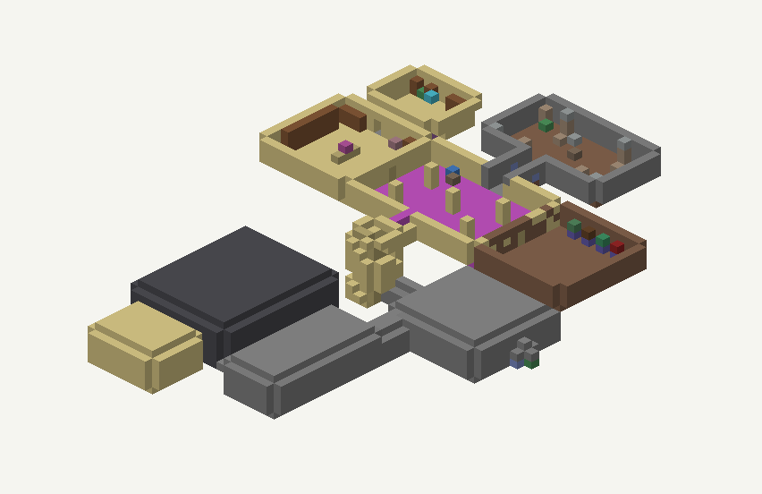

# Druid Sanctuary (`heraldia:unicas/santuario`)

A clearing in the birch forest ringed by menhirs, with a huge **sacred birch** in the middle: its hollow trunk holds
a spiral staircase that goes up to a platform under the canopy and down to the roots, where the druids dug their
library, their herbalist's room and the ossuary of their faithful. The tree is withering: the archdruid **Cadoc**, who swore by
its roots to keep Ysolda's leaf, made a pact with dark powers to save it and now waits, **the Withered**, in the
rite chamber, next to the black stump of the first tree.

It is an original structure: it does not copy any sanctuary from another game or mod. It differs from the cathedral (forest and flower
forest) and from the forest family's village in that there are no walls: it is an open clearing, with small round huts and
a single monumental tree, and everything valuable is underground.

## Biome and placement

- Biomes: birch forest and old growth birch forest, plus `#c:is_birch_forest` (which in vanilla are exactly
  those two: biome mods' birch forests come in; `biomes.check` checks it). Until now there was no
  unique structure in them.
- Rarity: `spacing` 250 / `separation` 190 chunks (one every ~3,000-5,000 blocks), configurable in
  `config/heraldia.json` like the others (`unicas.santuario.activada`, `unicas.santuario.separacion_bloques`).
- Two rigid pieces joined by a vertical jigsaw under the entrance path (`down_north` → `up_north`, same rotation):
  - `claro` (72 × 32 × 72): a disc 72 in diameter; its y = 0 layer is the ground (feet go at y = 1).
  - `raices` (49 × 14 × 63): everything below y = 0. **It fills its whole box**: dirt in the top two
    layers, stone below, and a lining (rooted dirt and birch wood in the root hall, planks in the
    library, mud brick in the herbalist's room, cut stone or polished deepslate elsewhere) on every face that faces
    air, so that no springs or lichen appear inside.
- `beard_thin` adaptation: the terrain adjusts to the base of the clearing (y = 0) and the roots stay at their depth, without a
  crater (see "Basements without a crater" in `docs/LESSONS.md`). Inside the clearing (radius 30) there is explicit air up to 6
  blocks above the ground, so that no hillside pokes out between the huts.
- **Nothing grows in the clearing**: the walked floor is dirt path with patches of moss carpet (the forest's trees, grass
  and flowers are not placed on it); the garden's beds and flower bed have a crop or a flower on
  every cell, so a tree cannot fit either. Outside radius 30 the ground is grass: there the forest grows back and the
  clearing blends into it. The audit fails if bare fertile soil is left inside the clearing.

## The clearing (feet at y = 1)

Coordinates: x from west to east (0..71), z from north to south (0..71); the entrance is to the north (z = 0). The tree is at the
center (36, 36). Plans in [`santuario/planos.txt`](santuario/planos.txt).

- A mossy cobblestone **path** from the entrance to the tree's door.
- **Sacred birch**: a trunk of birch logs 9 wide (radius 4.5) that narrows towards the canopy, with roots that
  spread at its foot (none to the north, where the door is) and patches of peeled bark. Inside, the **spiral
  staircase** (`pieces.spiral_stair`) goes from the roots (feet -11) to the canopy (feet 19), with shroomlights on the wall of the
  hollow. A door to the clearing and a door to the **canopy platform**: a ring of planks with a railing (which leaves no
  diagonal gaps) on log corbels, lanterns hanging from the canopy and the `copa` chest. The **canopy** is a dome
  of persistent leaves (they do not decay) 21 wide with branches inside; it has gaps where the tree is withering.
- **Stone circle**: twelve stone and andesite menhirs around the tree (radius 13); two have fallen.
- **The druids' huts** (three, to the west): round, a cobblestone plinth, mud brick walls with stripped birch
  posts, windows on the straight stretches and a solid thatched conical roof. A bed, the `cabana` chest, a barrel, a flower pot and
  something of each one's trade (crafting table, cauldron, composter). The southern one has its roof partly caved in.
- **The archdruid's hut** (northeast): larger, with a bed, a chest, a lectern and a brewing stand. Behind the **green tapestry** of the
  east wall, a 1 × 2 passage leads to his **hidden alcove** (no other exit): the `archidruida` chest.
- **Herb garden** (southwest): a birch fence with a gate, beds of wheat, carrot, beetroot and potato
  watered by two ditches, a flower bed (allium, cornflower, lily of the valley...), two **beehives** with honey and the
  `jardin` barrel. A central path.
- **Stone pond** (southeast): a basin raised by one block, with lily pads.
- **Observatory of aligned stones** (east): a round dais with a **gnomon** and, to the east, three stones towards the
  sunrises: "Summer sun" (northeast), "Equinox sun" (east) and "Winter sun" (southeast). The gnomon
  carries the **riddle**: "Light the solstices; leave the equinoxes dark". The `observatorio` chest.

## The roots (piece `raices`)

Upper level (feet at y = -5) and lower level (feet at y = -11), both joined by the tree's staircase.

1. **Root hall** (upper level, north of the tree): wooden pillars, hanging roots and cobwebs; dark,
   with a **spider spawner** and the `raices` chest.
2. **Library** (west): bookshelves, a reading table, a lectern and the `biblioteca` chest, which holds the **Chronicle
   leaf**. A stretch of bookshelf in the north wall is the **secret door** (puzzle 2): its lever is at floor level,
   three blocks further on. Behind it, the **archive** (hidden room): bookshelves, a lectern and the `secreto` chest.
3. **Herbalist's room** (east): brewing stands, cauldrons, a composter, barrels with flower pots, a long table for drying herbs, the
   `herbolario` chest and barrel.
4. **Tripwire corridor** (north): **trap 1**, a tripwire with two arrow dispensers at head
   height.
5. **Ossuary of the faithful**: piles of bones and skulls, the `osario` chest, a sign ("The faithful rest at the foot of the
   tree") and a **zombie spawner**.
6. **Offering room** (lower level, east of the tree): pots and candles, a **skeleton spawner**, the
   `raices` chest and, at the back of a niche in the east wall, the **offerings** chest with two pressure plates in front of it and an
   arrow dispenser on each side of each plate (**trap 2**).
7. **Sun chamber** (puzzle 1): the west wall has four chiseled brick **season stones**, each
   with its lever and its sign: spring, summer, autumn and winter. The mossy stone door only opens with
   **the solstices lit (summer and winter) and the equinoxes off (spring and autumn)**: the riddle is
   on the clearing's gnomon and the aligned stones explain it. The correct levers turn off two inverting torches that
   power the pistons' line; the fake ones power it directly with dust, so with any fake stone
   lit the door stays closed (or closes again). It is the same piece as the rune wall of Jarl's
   Hall (`pieces.combo_door` with two fake levers), already tested on a server.
8. **Rite chamber** (hidden): polished deepslate, black tapestries, a circle of mossy stones around the
   **black stump** of the first tree and lit candles. It is patrolled by the **guardian**, the **archdruid Cadoc, the Withered**
   (an evoker, 50 health, armor 4; his vexes are his only escort). The `ritual` chest.
9. **Treasure chamber**, south of the rite chamber: the **premium** chest, a gold block with candles, a barrel, pots and posts.

## Player route

Entrance → clearing (free: huts, garden, pond, observatory, circle) → the tree's door → stairs up to the
canopy platform, or down → root hall → library (lever → archive), herbalist's room, tripwire
corridor → ossuary. Further down → offering room (the niche with the trap) → sun chamber → combination → rite chamber →
treasure. In the archdruid's hut, behind the tapestry, the alcove. Everything has a way back to the entrance without jumps (the
audit checks it; you get out of the ditch and the pond by swimming).

## Puzzles and traps (everything at rest and consistent when generated)

- **Puzzle 1, the season stones** (`pieces.combo_door` with two levers and two fake ones): extended sticky pistons
  holding two blocks of mossy stone; the line of dust runs inside the wall (four thick: levers,
  torches or the fake ones' dust, door and pistons with the line, and the face of the rite chamber). The 16
  combinations are tried.
- **Puzzle 2, the archive's secret bookshelf** (`pieces.lever_door`): two bookshelves at the back of a niche; the lever
  turns off the inverting torch and the pistons pull them in. Pistons and torch stay inside the wall.
- **Trap 1**: a taut tripwire between two hooks with a dispenser above each hook (`pieces.tripwire_trap`).
- **Trap 2**: two stone plates in the offering niche, each with a dispenser on each side
  (`pieces.plate_trap`).

## Enemies and entities

- **3 spawners**, all underground and in the dark (block light 0 within a radius of 4): spiders (root hall),
  zombies (ossuary) and skeletons (offering room).
- **Guardian**: the archdruid Cadoc (the only one with the `heraldia_guardian` tag; he drops his trophy if a player kills him,
  and his usual evoker loot).
- No villagers, golems or animals; the beehives are empty (with honey). In total, **1 entity** per structure.

## Chests (18) and loot

Richer the more hidden they are; each table has an extra `solo_sin_lootr` pool.

| Table | Where | Contents |
|---|---|---|
| `cabana` (4) | the druids' and the archdruid's huts | bread, honey, berries, seeds, bone meal, wool, candles; extra: emerald, nuggets, golden carrot |
| `jardin` (barrel) | garden | seeds, crops, bone meal, honeycomb, flowers, shears; extra: Clearing Honey, glistering melon |
| `observatorio` | the observatory's dais | paper, candles, compass, clock, amethyst, map; extra: spyglass, lapis lazuli |
| `copa` | canopy platform | arrows, a worn bow, string, feathers; extra: Birch Bow (enchanted) |
| `archidruida` | hidden alcove | gold, emeralds, amethyst, Golden Mistletoe, enchanted book, regeneration potion; extra: diamond, golden apple, the Pilgrim's Staff |
| `biblioteca` | library | books, paper, feathers, ink, Written Bark **and the Chronicle leaf**; extra: enchanted book |
| `secreto` | hidden archive | enchanted books, Treatise on the Roots, amethyst, lapis lazuli; extra: diamonds, "mellohi" disc |
| `herbolario` (chest and barrel) | herbalist's room | bottles, sugar, mushrooms, glow berries, potions; extra: the Herbalist's Remedy, glistering melon |
| `raices` (2) | root hall, offering room | string, glow berries, mushrooms, iron nuggets, coal; extra: iron, emerald |
| `osario` | ossuary | bones, rotten flesh, gold nuggets, skull; extra: ingots, bottles o' enchanting |
| `ofrendas` | offering niche (trap) | heaps of gold and emeralds, Clearing Honey, amethyst; extra: diamonds, gold block |
| `ritual` | rite chamber | redstone, glowstone, lapis lazuli, amethyst, the Rite Dagger; extra: diamonds |
| `premium` | treasure chamber | 90 %: Seed of the Sacred Tree, Crown of Leaves, Birch Bow, Golden Mistletoe, armor trims (wild, wayfinder, raiser), discs, gold, emeralds, enchanted book; 10 %: an enchanted diamond axe or leggings, an enchanted golden apple or a totem |

No netherite or elytra.

## Trophy and Chronicle

- **Trophy**: *Cadoc's Golden Sickle* (a rare gold hoe, Efficiency 2, Unbreaking 2): "It reaped the mistletoe of the sacred
  tree. In the end it reaped its roots as well".
- **Leaf** (`biblioteca` chest): Ysolda reaches the clearing, the druids give her bread and honey and the archdruid Cadoc listens to her
  under the tree; he swears by its roots to keep the leaf and puts it among the written barks of his library. When the
  tree began to wither, Cadoc made a pact with dark powers to save it. The clue with which the leaf of Jarl's
  Hall points to it: "the birch forest, where a sacred tree raises its canopy over a circle of stones". Its own points to the
  Wizard's tower.

## State of conservation

Visible surface damaged: **17 %** (computed over the clearing's blocks with a face to the outside air, without the walked
floor or the moss carpets: the hand-made ruin plus what is expected from the processor). Hand-made ruin: gaps in the
canopy (the tree is withering) and patches of peeled bark on the trunk, two fallen menhirs, the caved-in roof of
the southern hut (with thatch fallen inside), broken stretches of the garden fence and the pond's cracked wall.
Processor: cobblestone → mossy (30 %), stone brick → cracked (12 %) or mossy (10 %), mud brick → packed mud
(10 %) and broken panes (30 %). Nothing that holds up a mechanism changes its solidity.

## Audit (a condition for generating)

`audit.py` fails the build if: the redstone is not in its stable state; any of the 16 combinations of the
season stones opens without being the correct one (or the correct one does not open); the lever does not open the archive; the wire or the
plates do not fire (or a dispenser has a signal at rest); something hidden (archive, rite chamber, treasure) can be
reached without solving the puzzles or cannot be reached by solving them; the alcove cannot be reached through the tapestry; there are chests,
spawners or levers out of reach, doors without an exit, stairs without headroom, cells without a way back to the entrance
(strict walk without falls, swimming in the water), spawners with light, loose blocks, natural rock in sight
underground, bare fertile soil in the clearing, the number of chests falls outside 15-25 or the damaged surface outside 15-20 %.
The shared checks also run (`lint.support_issues`, `access_issues`, `door_pair_issues`,
`stair_headroom_issues`) over the whole build. Negative cases checked: a changed solution, the archive's torch
removed and a lantern next to the spider spawner.

## Performance

- Generation: two templates (about 25,200 + 43,200 blocks, on the order of Jarl's Hall) with a rule processor and
  without custom Java. Generating the module takes about 2 s in Python. `/place structure` of the whole structure took 381 and 718 ms (two runs) on
  the test server (printed by `smoke_server.py`).
- Entities: 1 (the guardian). 3 spawners with the vanilla radius and limit. Nothing per tick.

## Tests

- `python3 tools/gen/uniques/sanctuary/blueprints.py` → plans by level and renders in `docs/unicas/santuario/`.
- `python3 tools/gen/uniques/sanctuary/smoke_server.py --jar build/libs/heraldia-<version>.jar --work "$PWD/build/smoke"`:
  places the structure (measures the time and counts entities) and the templates unrotated to check chests, spawners,
  water, beehives and leaves, and to operate the season stones (also with a fake one), the archive's bookshelf,
  the tripwire and the offering plates. It is in the CI matrix.

## Renders

